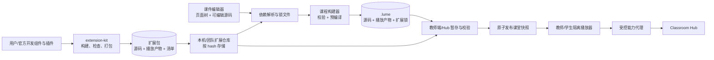

# 课件内容规范、插件与组件库设计

状态：**2026-09-26 源码评估、目标方案与扩展组件首轮闭环**。`packages/component-extensions`、`packages/course-model` 和 `apps/editor` 已支持 `.lumex` 声明式组件包导入、组件属性编辑、精确版本/hash 锁定、保存重开和课程内离线封装；当前 Core 源码验证包摘要并以白名单 React 元素渲染。首轮仅支持受限模板与字段表单，不运行包内 JavaScript；交互插件、资源与样式资产、主题包、扩展 API、独立隔离运行时和发布仓库仍属后续设计。先阅读[课件渲染评估](/architecture/course-rendering)与[当前格式和 SDK](/reference/course-format-sdk)了解播放链路。

## 已实现的声明式组件包切片

当前 `.lumex` 是只含根目录 `extension.json` 的 ZIP。`@lumesync/component-extensions` 校验包 ID、semver、组件命名空间、props 默认值和模板；模板只允许有限 HTML 标签、样式属性、静态文本和 props 引用。脚本、事件处理器、任意 HTML 属性、外链与其他 ZIP 条目都会被拒绝。可编辑字段类型为文本、数字、布尔值、颜色和枚举。

编辑器导入包后将其放入本机组件库，并把 `{id, version, hash}` 加入课件扩展锁。保存 `.lume` 时，组件定义写入 `source/extensions/<id>.json`；源码摘要包含该定义，课件可离线重开和播放。Core 在加载时重新验证包格式和 hash，校验所有自定义块的锁与属性，再将受限模板映射到 React 元素。生成的 TSX 仍作为旧版 Core 的兼容输出，但新 Core 对编辑器格式走 JSON 直渲染。

一个课件当前对每个扩展 ID 只能锁定一个版本。扩展包是自包含的；课堂端不需要安装本机 `.lumex` 文件或访问网络。当前模板不支持插槽、图片/字体等包内资产、动态行为、课堂状态 API 或第三方 React 组件，因此它适用于新布局和信息卡片，不等同于完整的代码插件系统。

组件定义示例：

```json
{
  "format": "lumesync-component-pack",
  "formatVersion": "1.0.0",
  "id": "org.example.cards",
  "version": "1.0.0",
  "displayName": "课堂卡片",
  "components": [{
    "id": "org.example.cards.fact-card",
    "label": "知识卡片",
    "props": {"title": {"type": "string", "label": "标题", "default": "新知识"}},
    "template": {"tag": "article", "style": {"padding": "20px"}, "children": [{"tag": "h2", "children": [{"prop": "title"}]}]}
  }]
}
```

在 Node.js 中可用 `@lumesync/component-extensions` 的 `writeComponentPack(pack)` 将该对象打包为 `.lumex`，`readComponentPack(bytes)` 可在导入前校验并计算 hash。模板只接受仓库内置的安全标签和样式白名单；组件库开发者指南见 `packages/component-extensions/README.md`。

### 创建和发布用户组件

仓库提供 `lumex-component` 开发命令。当前工作区可直接用 Node 调用，不需要额外安装工具：

```sh
node packages/component-extensions/bin/lumex.cjs init org.school.science "科学组件" --version 1.0.0
# 编辑 extension.json 中的组件 label、props、默认值和 template
node packages/component-extensions/bin/lumex.cjs validate extension.json
node packages/component-extensions/bin/lumex.cjs pack extension.json science-1.0.0.lumex
node packages/component-extensions/bin/lumex.cjs validate science-1.0.0.lumex
```

`init` 会生成一个包含标题、正文和强调色的卡片样例；`validate` 对 JSON 源文件或 `.lumex` 成品执行同一份契约校验并输出稳定 hash；`pack` 只在输出路径不存在时写入 ZIP。开发者编辑的是普通 JSON 源文件，可以持续修改、重新校验和打包。发布有兼容性影响的修改时应升级 semver；课程保存包版本和 hash，原课件不会被个人组件库后续更新悄悄改变。CLI 与编辑器导入共享 `@lumesync/component-extensions` 校验器，避免开发期和播放期接受不同格式。

首版生成的包仍只包含声明式模板。开发者不能在包中加入 JS、CSS 文件、媒体、事件或远程依赖；这些能力需要下一版明确的运行时和权限契约。命令与可直接调用的 Node API 见组件包源码目录的 `README.md`。

## 架构决策

第一版采用**声明式课件 + 可编译组件 + 受控功能插件**。课件源文件保持可编辑，发布时生成不可变的播放产物。扩展以 `id + version + hash` 锁定；编辑器、教师端、Hub 和学生端共享格式/兼容性判定，但只有编辑器和发布端运行编译工具。课堂播放器不运行 Babel，不从公网临时下载依赖。



这里的“插件”是可安装的扩展包；“组件”是扩展包提供的一种扩展点。官方标准组件、学校组件和个人组件都走相同协议。主题也是扩展包的一种；具有服务端能力的插件必须单独部署，不随课件自动启动。

## 判断：统一包结构还不足以保证课件兼容

当前 `course-format` 已规定 ZIP 路径、大小、manifest、`schemaVersion` 和页面文件是否存在，并用于教师服务扫描和 Hub 上传。新编辑器格式的四种内置组件已有直接 JSON 渲染分支；任意 TSX/JS 旧课件仍由 Babel 编译并通过 `new Function` 执行，且没有隔离沙箱。它只映射 `react`、`react-dom` 和 `@lumesync/course-sdk` 这几个 import，其他依赖靠全局脚本与 CDN 回退。可用的全局变量、CSS 类、组件属性、SDK 行为与引擎版本没有一份共同的内容契约。

| 缺口 | 现在的证据 | 容易出现的现象 |
| --- | --- | --- |
| 内容 API 没有版本 | `types/lumesync-course-sdk.d.ts` 声明 `registerSyncVar` / `registerVar`，当前 Core 未注入；页面 `require` 映射到可变 `window.CourseGlobalContext`（Core `runtime/app.tsx:127-160`） | 类型检查通过，课堂运行时报错；切课时读取旧上下文。 |
| 模块与依赖规则不完整 | Core `runtime/app.tsx:476-507` 在页面代码执行后才加载 `dependencies`；不支持课件内模块的常规相对 import | 作者在编辑器或本地构建可运行，课堂里找不到模块或初始化顺序错误。 |
| 组件注册依赖全局和固定打包顺序 | Core `src/node/render-engine.ts` 手工列出 `vote-slide`、`survey-slide` 等文件；组件调用 `window.CourseGlobalContext` 或 Socket（如 `course-components/vote-slide.tsx`） | 增加组件需要改引擎；第三方组件难以按版本安装、隔离和复用。 |
| 外观依赖宿主样式 | 示例 TSX 使用大量 Tailwind 类；`survey-slide.tsx` 拼接 `bg-${颜色}` 等动态类；manifest 未声明样式版本或主题依赖 | 构建裁剪、宿主 CSS 更新或编辑器/学生端样式不同，导致缺样式与布局偏差。 |
| 格式版本与运行环境混在一起 | 共享 manifest 只固定包 schema；`runtime.react`、`slideModule` 等字段主要是默认值，未形成可执行的兼容检查（`packages/course-format/src/manifest.js:70-121,200-226`） | 包合法，但其 React、组件、SDK 或浏览器特性与播放器不匹配。 |
| 内容包与动态插件没有锁定关系 | 现有 `dependencies` 指向本地/公网脚本，未记录安装源、不可变摘要、权限和导出支持 | 同一课件在不同机器或离线教室加载到不同代码。 |

现有 `GET /api/components-manifest` 仅按文件名列出 `public/components/*.js`，Core 独立服务甚至返回空列表；它不是带版本、能力、依赖和校验的插件注册表。上表是静态源码判断，具体跨机不兼容案例仍需用固定样本验证。

## 推荐的内容模型

将内容分成四层，各层有独立的版本与所有者：

| 层 | 作用 | 作者怎么使用 | 运行位置 |
| --- | --- | --- | --- |
| 课件文档 | 页面顺序、资源、组件树、主题参数、互动配置 | 编辑器表单或 JSON；默认创作方式 | 由播放器解释，不执行任意代码 |
| 组件包 | 展示和局部交互，如时间轴、公式、投票卡片 | 从组件库选择并配置属性；可由用户开发 | 隔离播放器内，由 SDK 提供受控能力 |
| 功能插件 | 扩展数据源、媒体、互动协议、编辑器面板或导出适配 | 管理员或教师显式安装、授予能力；课程声明依赖 | 按扩展点运行在受限环境；服务端插件单独授权 |
| 主题包 | 颜色、字体、布局 token 与样式资源 | 选择主题并覆盖 token | 限定在课件根容器；不修改宿主 UI |

组件可以只包含声明式 schema 和渲染模板；需要 JavaScript 时才走代码包。一个插件可提供多个组件，但“渲染一个卡片”不应强制引入拥有网络、文件或课堂事件权限的插件。官方标准组件与用户自定义组件使用**同一打包和运行协议**，差别只在发布渠道、审核与默认信任级别。个人组件可随课件封装；学校或团队组件可放在受管仓库；官方组件可预装但仍显式标记版本。

## 课件与扩展包的契约

建议保留 `.lume` ZIP 容器，新增独立的 `contentVersion` / `runtimeApi` / `renderer` / `lock` 概念。**不要直接把下例字段当作当前 `schemaVersion: 1.0.0` 的既有定义**；需在 `course-format` 中先发布新 schema，再做迁移器。

```json
{
  "schemaVersion": "2.0.0",
  "id": "physics-motion",
  "runtime": {
    "format": "lumesync-zip",
    "entryMode": "document",
    "contentVersion": "1.0",
    "apiRange": "^1.0",
    "rendererRange": "^2.0"
  },
  "pages": [{"id": "intro", "file": "pages/intro.json"}],
  "theme": {"package": "org.example.theme.clean", "version": "1.2.0"},
  "extensions": [
    {"id": "org.example.charts", "version": "1.4.2", "hash": "sha256:...", "required": true}
  ],
  "lockFile": "extensions.lock.json"
}
```

页面可以用稳定的组件树表达：

```json
{
  "id": "intro",
  "layout": "slide-16:9",
  "children": [
    {"type": "core.heading", "props": {"text": "匀速运动", "level": 1}},
    {"type": "org.example.charts.line", "props": {"dataAsset": "assets/motion.csv", "x": "time", "y": "distance"}}
  ]
}
```

`type` 必须是带命名空间的稳定组件 ID。组件包发布自己的 props JSON Schema、默认值、可编辑控件描述、可选插槽、事件与辅助功能语义。编辑器和播放器共用同一个 schema：编辑时实时校验，发布前完整校验，播放时拒绝不受支持的必需组件并给出组件名与版本。对于仅装饰性的可选组件，可按包内定义的静态占位内容降级；不能静默丢弃教学关键内容。

对于后续的**代码型插件**，目标是扩展 `.lumex` ZIP：包含清单、浏览器构建产物、样式、资源、类型声明与可选编辑器/导出入口。清单定义反向域名 ID、版本、SDK/播放器范围、扩展点、能力、资源上限、构建目标、入口文件和各文件 hash。**这部分是目标协议，不是当前首轮 `.lumex` 格式**；当前实际导入包仅含 `extension.json`，无 JS/资源入口。目标协议里课件仍按精确版本和 hash 锁定，课堂不从未锁定 CDN 拉取脚本。

### 可编辑课件与播放产物

预编译后仍可修改课件，前提是 `.lume` 同时保存源内容和生成产物。建议目录如下；字段与扩展名均待新 schema 定稿：

```text
lesson.lume
├── manifest.json
├── extensions.lock.json       # 精确版本、hash、来源和能力决定
├── source/
│   ├── pages/intro.json       # 声明式页面
│   └── code/experiment.tsx    # 可选代码页，供再次编辑
├── assets/
└── build/
    ├── entry.js               # 面向目标 WebView 的已编译入口
    ├── styles.css
    └── build-manifest.json     # 输入摘要、工具链/SDK 版本、文件摘要
```

编辑器始终修改 `source/` 和 `assets/`，保存时重新解析依赖并构建 `build/`；`build-manifest.json` 记录源文件、扩展锁、目标运行时和构建工具版本的摘要。若摘要不匹配，导入端拒绝旧产物并要求重建，不能悄悄执行过期代码。教师端/HUB 校验并分发产物，学生端只校验 hash 与加载。课堂中已发布的 `courseHash` 保持不变；修改课件产生新 hash，教师明确发布后才切换。

第一版扩展包也保留可选 `source/` 方便作者维护，但播放器只接收 `dist/`。源文件本身并不构成可执行凭据；有合法产物和完整锁文件才能进入课堂。课件对扩展的声明可使用版本范围供**编辑时选择**，`extensions.lock.json` 必须记录解析后的精确版本与摘要；播放时不重新解析范围。

### 扩展包清单示意

```json
{
  "formatVersion": "1.0",
  "id": "org.example.charts",
  "version": "1.4.2",
  "apiRange": "^1.0",
  "runtimeRange": "^2.0",
  "entrypoints": {
    "player": "dist/player.js",
    "editor": "dist/editor.js",
    "export": "dist/export.js",
    "style": "dist/style.css"
  },
  "provides": {
    "components": [
      {"id": "org.example.charts.line", "propsSchema": "schemas/line.json", "renderMode": "interactive"}
    ],
    "interactions": []
  },
  "capabilities": ["asset.read"],
  "files": {"dist/player.js": "sha256:...", "schemas/line.json": "sha256:..."}
}
```

`files` 应覆盖**所有**安装与播放会读取的条目，示意中省略了其余条目。包级 hash 覆盖规范化后的包内容；同一 `id + version` 若对应不同 hash，安装器必须报冲突。组件 ID 由包 ID 派生，不能冒充 `core.*` 或其他包的命名空间。官方组件的“标准”身份由受信任发布源与签名记录决定，用户组件无需等待官方收录即可在个人/团队范围使用。

## 开发者接口与注册机制

建议发布 `@lumesync/content-sdk` 与 `@lumesync/extension-kit`：前者为作者提供页面、资源和互动 API，后者提供组件/插件注册及构建工具。类型、运行时实现、schema 和示例从同一包版本发布，避免现有 `.d.ts` 与运行时漂移。最小形态示意：

```ts
export default defineExtension({
  id: 'org.example.charts',
  version: '1.4.2',
  api: '^1.0',
  components: [
    defineComponent({
      id: 'org.example.charts.line',
      propsSchema: lineChartPropsSchema,
      render: LineChart,
      editor: lineChartInspector,
      export: renderStaticChart
    })
  ]
});
```

这段代码是**建议接口**，目前不可在仓库中直接运行。注册表按 `id + version + hash` 索引，不允许课件加载时覆盖已注册组件。组件依赖由构建工具打包或声明为平台受控依赖；同一隔离播放器内只共享一份 React 和 SDK，避免重复 React 导致 Hook 错误。组件 props、输出事件和能力请求通过 schema 校验，组件仅取得其声明的 `context`，不取得原始 Socket、`window.CourseGlobalContext` 或原生桥。

### 注册与生命周期

注册是**纯声明阶段**，不能在 `register` 时启动摄像头、连接网络或订阅课堂事件。每个扩展包的播放器入口只暴露声明和工厂；运行时按如下顺序处理：

1. `resolve`：根据锁文件找到精确 hash；校验来源、签名或本机信任记录、文件摘要、SDK/运行时范围与能力授权。
2. `prepare`：在隔离环境内加载代码和样式，验证组件 ID 唯一、属性 schema 与入口导出；失败不替换当前课件。
3. `mount`：在课程实例上下文中创建组件。实例只得到 `courseId`、组件实例 ID、资源读取器、局部状态和已授权能力代理。
4. `update`：属性更新只传经过 schema 校验的数据；互动消息带课程 hash、页 ID、组件实例 ID、事件类型和请求 ID。
5. `dispose`：取消订阅、定时器、媒体流、Object URL 与未完成请求；切课、卸载、热更新和失败回滚都必须调用。

注册表有两个层次：**安装目录**记录设备已有的包及信任来源，**课程实例注册表**只包含锁文件列出的组件/插件。后者在 `dispose` 时整体销毁，防止一个课件覆盖下一课件的全局组件。编辑器的组件选择器显示 ID、版本、来源、能力和兼容状态；添加组件时写入课程依赖，移除最后一个引用后可在下一次构建中剔除未用依赖。

### 依赖解析与版本规则

- 格式版本、内容模型版本、SDK API 主版本、播放器版本、组件包版本分别管理；`schemaVersion` 不代替 SDK 兼容性。
- 扩展可声明构建时依赖。第一版将普通第三方库打入扩展产物，只允许 React 和内容 SDK 作为平台提供的 peer dependency；禁止播放时解析 npm 包或公网 URL。
- 同一课程内组件包按精确版本锁定。若两个包要求互不兼容的平台 SDK/React 主版本，发布前报冲突；不能在一个 React 树中偷偷加载第二份 React。
- 课程包、扩展包及锁文件以内容 hash 组成发布快照。Hub 暂存全部字节并验证后才公布快照；学生先获取并验证所有必需扩展，再确认准备就绪，之后按 Hub 状态切换。缓存按 hash 复用，正在使用的快照不可驱逐。
- 已发布课程升级扩展时生成新锁和新 `courseHash`。组件 props 的破坏性变化由该组件包提供显式迁移器，编辑器展示变更并保存新课件版本；课堂播放端不自动迁移。

插件扩展点应白名单化并分阶段开放：

| 扩展点 | 用途 | 能力与边界 |
| --- | --- | --- |
| `component` / `theme` | 新组件、外观和布局 | 默认仅接收 props、资源读取器、局部状态；样式限制在课件容器。 |
| `editor.inspector` / `editor.template` | 属性面板、页面模板 | 仅作用于编辑器；不能被课堂播放端加载。 |
| `classroom.interaction` | 投票、协作画板、实验数据同步 | 经 SDK 发声明式事件；Hub 按插件 ID、课堂角色、schema 和速率校验。 |
| `media.adapter` / `export.renderer` | 特殊媒体、PDF/图片导出 | 明确离线能力和超时；缺少导出适配时显示静态占位或禁止该导出。 |
| `server.connector` | 以后接学校数据源或设备 | 独立安装与管理员授权，不能随普通课件自动执行。 |

## 安装、发布与安全边界

1. **开发**：提供脚手架、组件预览、属性 schema 校验、单元样本和导出样本；作者可将自定义组件打包随课件使用，也可发布到私人/团队仓库。开发文档提供最低 SDK 版本、禁止依赖的全局变量及能力请求范例。
2. **导入**：教师或管理员选择扩展包；系统验证 ZIP、清单、hash、签名来源或本地信任决定、版本范围与能力清单。用户可看到该扩展请求的能力。普通组件允许本地安装；服务器连接器、设备控制等高权限插件须单独管理。
3. **发布课件**：编辑器将所用组件、主题、插件的确定版本和 hash 写入锁文件。教师端或 Hub 在广播课程前解析完整依赖图，检查冲突、循环、缺包、SDK 范围和离线资源，准备好后原子切换课程快照。缺失必需扩展时拒绝发布并列出解决方法。
4. **播放**：课件代码和扩展代码进入隔离 origin/进程；宿主通过带来源、课件 hash、扩展 ID 和请求 ID 的消息通道授权能力。CSP 限定脚本/网络来源，插件不能直接读教师管理接口、学生原生桥或其他课件数据。隔离方案应与[渲染架构](/architecture/course-rendering#建议的目标边界)一起原型验证。
5. **升级与回退**：已发布的课件快照继续使用锁定扩展；新版本安装为并存版本，迁移 props/schema 需要显式迁移器与预览确认。回滚切换到旧的课程 hash 和扩展锁，不自动覆盖历史文件。

### 隔离粒度与权限模型

组件代码和课件代码在同一个播放器 iframe 中运行时，它们**共享该 iframe 的 JavaScript 权限**。不能仅凭消息里自报的 `pluginId` 对同一 iframe 内的两个扩展执行不同的强权限策略。因此第一版做以下区分：

| 执行域 | 内容 | 权限 |
| --- | --- | --- |
| 宿主教师/学生 UI | 课堂导航、原生桥、Socket 凭证 | 不加载课件或插件代码；只处理经 schema 校验的消息。 |
| 每门课的隔离播放器 | 声明式页面、代码页、普通组件与主题 | 共享课程级最低权限；不能直接访问宿主 DOM/Socket/原生桥。适合 `asset.read`、局部状态等低权限能力。 |
| 单独隔离的能力插件 | 需要网络、摄像头或特殊互动的扩展 | 每插件独立 origin/iframe 或等效进程，使用绑定实例的消息通道；宿主按安装记录授予能力。 |
| Hub 的服务端插件 | 数据连接器等高权限逻辑 | 独立进程/服务、管理员安装、单独凭证与审计；不由课程包自动激活。 |

宿主在创建消息通道时绑定课件 hash、扩展包 hash 和实例身份；权限判断依据**宿主持有的通道记录**，不相信消息 payload 自报身份。每个动作需检查课堂角色、课程版本、能力授权、payload schema、大小与频率；不允许透传任意 HTTP/Socket 或原生动作。播放器 iframe 使用独立来源与受限 CSP；具体 sandbox 标志要与资源、摄像头和本地缓存需求一起验证，不能只加一个 `sandbox` 属性便认定安全。

### 外观与导出一致性

主题包只发布设计 token、字体与受限样式，不直接修改宿主 `body`、教师工具栏或学生状态栏。组件样式在课件容器内生效；构建器收集实际使用的类与 CSS，禁止依赖运行时拼接而未经生成的 Tailwind 类。建议使用 CSS Modules/作用域类加主题 token；复杂代码组件可在隔离容器内使用自有样式。课堂与编辑器预览加载同一个播放器产物和同一主题版本。

每个组件必须声明 `static`、`interactive`、`exportable` 能力。导出适配器使用与课堂相同的 props 和资源快照；实时投票、摄像头等不能自然静态化的内容需提供指定占位图/结果快照，或让编辑器在发布前提示“此页不可导出”。预览、教师端、学生端和导出各有固定样本图与交互契约测试，而不只检查编译成功。

## 模块归属与公共接口

| 模块 | 唯一职责 | 依赖方向 |
| --- | --- | --- |
| `packages/course-format` | `.lume` 新 schema、源/产物/锁文件校验、旧课迁移 | 不依赖 UI 或 Hub。 |
| `packages/content-sdk` | 页面运行时 API、消息 schema、能力名、React Hook 与类型 | 播放器和组件依赖它；不暴露 Socket。 |
| `packages/extension-format` | `.lumex` 清单、包校验、hash、签名元数据和兼容规则 | 编辑器、教师端、Hub 共用。 |
| `packages/extension-kit` | 开发脚手架、构建器、组件 schema 校验、打包和本地预览 | 只在制课/发布时使用。 |
| `packages/component-registry` | 已安装包索引、课程级解析、版本冲突与缓存引用 | 不执行扩展代码。 |
| `packages/course-player` | 隔离播放器、组件实例注册表、生命周期、主题和导出适配 | 使用内容 SDK 与格式库；不持有教师身份。 |
| `apps/editor` | 源码与页面树编辑、组件选择器、升级/迁移提示 | 调用构建器和同一播放器预览。 |
| 教师端 / Classroom Hub | 扩展安装、暂存、授权、按 hash 分发与课堂快照 | 使用格式/注册表；Hub 校验互动消息。 |

这些是**目标逻辑包名**，不是当前仓库中已存在的目录。`classroom-protocol` 继续拥有课堂事件的信封、角色与错误码；插件互动 schema 在 content SDK 定义组件事件，再由 Hub 通过课堂协议承载。组件不能直接扩展任意 Socket 事件名。

### 对外操作面（建议）

```text
extension install(file | trustedRegistryRef) -> {id, version, hash, capabilities}
extension list(scope) -> installed packages + compatibility
extension remove(id, version, hash) -> rejects if a published snapshot still pins it
course validate(file) -> source/build/lock diagnostics
course build(source, lock, targetRuntime) -> immutable .lume + courseHash
course stage(file) -> missing extensions / incompatibilities / prepared snapshot
course publish(preparedSnapshot, hostLease) -> revision + courseHash
```

接口名只是设计草案。实际 HTTP/IPC 命名应归入现有共享契约；安装、删除和发布必须按 host/管理员角色授权，学生只可读取当前已发布快照所需的包。一个端到端成功场景应覆盖：用户编写自定义组件 → 本地导入 → 编辑器显示配置表单 → 编译课件 → 教师直接模式播放 → 中继模式预分发 → 学生离线缓存播放 → 修改源码重建 → 教师切换新版本 → 回退旧版本。

## 实施顺序

| 阶段 | 工作 | 完成判据 |
| --- | --- | --- |
| 1. 内容规范 | 以 `course-format` 定义新 schema、声明式组件树、版本协商、扩展锁与迁移；列出当前课件所用 React/全局 API | 示例课件能被编辑器、教师端和学生端同一校验器接受；不兼容项有可读错误。 |
| 2. 标准组件库 | 先迁移 Heading、Text、Image、Video、Layout，再迁移 Vote、Survey、WebPage；提供 props schema、主题 token、预览与静态导出 | 同一组件在预览/教师/学生/导出按相同输入呈现；无需改 Core 文件顺序即可加组件。 |
| 3. 自定义组件 | `.lumex` 打包器、注册表、本地导入、课程锁文件、离线缓存与组件 SDK | 用户写一个带资源的组件，导入后可在编辑器选择，并在断网课堂播放。 |
| 4. 功能插件 | 受控互动事件、能力代理、编辑器扩展点及导出适配；最后才开放服务端连接器 | 插件缺失/冲突/无权限时在发布前失败；隔离边界内无法访问宿主权限。 |
| 5. 旧内容迁移 | 旧 TSX 继续显式兼容；提供检测报告和逐页迁移器，无法自动转换的页保留为隔离的代码页 | 旧课可继续播放或给出准确迁移原因，新课默认走声明式内容与锁定组件。 |

关键取舍：允许用户写代码以获得扩展性，但新课件的默认路径应是声明式页面加版本化组件；需要任意代码的课件和插件必须经过同一构建、锁定与隔离流程。这样组件可以不断增加功能和外观，同时课程作者不用了解宿主全局变量或课堂 Socket 协议。
