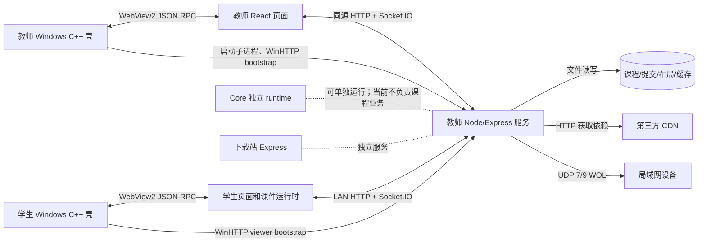

# 当前通信、身份与运行机制

状态：**源码现状**（2026-09-25 静态审查，2026-09-27 更新路径），不是未来中继协议。教师服务、Core 独立 runtime、下载站是不同进程；学生与教师的 Windows 壳通过 WebView2 承载页面。教师、学生和 Core 已并入根仓，跨端行为尚未实测。

## 进程和传输全景

| 边界 | 现有协议 | 目的 | 源码入口 |
| --- | --- | --- | --- |
| 页面 ↔ 教师服务 | HTTP/JSON、静态资源、Socket.IO | 课程目录、提交、课堂状态与事件 | `apps/teacher/server/index.js`、`src/routes.js`、`src/socket.js` |
| 教师/学生页面 ↔ 本机壳 | WebView2 WebMessage，JSON RPC/单向事件 | 本机配置、窗口、导入导出、截图、电源 | 两端 `native/shell/src/main.cpp` |
| 学生壳 ↔ 教师服务 | WinHTTP bootstrap；之后 WebView2 加载教师 URL | 获取 viewer 会话并进入课堂 | `apps/student/desktop/shell/src/main.cpp` |
| 教师壳 ↔ 子进程 | Windows 子进程及环境变量 | 启动 Node 服务、注入 token 与路径 | `apps/teacher/native/shell/src/main.cpp` |
| 教师服务 ↔ 网络 | HTTP/HTTPS 出站、UDP Wake-on-LAN | 依赖缓存和远程开机 | `src/proxy.js`、`src/socket.js` |
| GitHub ↔ 下载站 | HTTPS webhook、HMAC-SHA256 | 发布资产下载与版本元数据 | `website/server.js` |

当前没有 LAN 自动发现、验证码配对、远程教师控制租约或固定机中继服务。它们见[目标教师架构](/architecture/teacher-cross-platform-relay)。

## 启动与会话

1. 教师壳读取本机配置，启动教师 Node 服务子进程，通过 `LUMESYNC_HOST_TOKEN`、`LUMESYNC_VIEWER_TOKEN_SECRET` 等环境变量传入会话材料，并用 WinHTTP 调用 `/api/session/bootstrap` 获取 host 会话。
2. 教师服务启动 Express/Socket.IO，创建课程和缓存目录，扫描课件。HTTP 路由和 Socket 业务逻辑分别位于 `routes.js`、`socket.js`。
3. 学生壳读取固定教师机 IP/端口，调用同一 bootstrap 接口取得 viewer token，然后 WebView2 导航到教师服务页面。学生原生本地管理页与课堂远程页不是两套独立课堂服务。
4. 页面通过 `handshake.auth` 传 `role`、`token`、`clientId` 连接 Socket.IO；服务端分配 `hosts`/`viewers` 房间并下发当前课程与设置。断线重连时学生请求当前同步变量状态。

教师服务的 host token 是共享字符串，viewer token 是 `identity.ts` 签发的 HS256 会话 token，默认 4 小时；服务重启且未固定环境密钥时随机密钥变化，旧会话失效。迁移中已要求 host bootstrap 只接受带本机凭证的 loopback 请求，移除教师 Socket 的 IP 回退角色，并在 HTTP 管理路由增加 host bearer 校验。Core 独立 runtime 仍默认允许无角色声明的 legacy 模式。**viewer 资源授权和课件隔离尚未完成**，因此不能将现状当作可信网络接入方案。详见 [HTTP API](/reference/http-api) 与 [Socket 事件](/reference/socket-events)。

## 课堂状态与持久化

| 状态 | 当前位置 | 重启结果 |
| --- | --- | --- |
| 当前课程、页码、host 设置、连接/IP、投票、标注、监看图像、学生日志 | 教师 Node 进程内状态/Map；课程与页码已集中并带 `sessionId`/`revision` | 丢失或重新初始化 |
| 课程文件及文件夹 | `coursesDir`；文件夹元数据 `course-folders.json` | 保留 |
| 座位布局 | `classroom-layout-v1.json` | 保留 |
| 学生提交 | `submissionsDir`；目录选择在 `submissions-config.json` | 保留 |
| 依赖、模型、图片、字体 | `lib`、`weights`、`images`、`webfonts` 缓存目录 | 保留，受外部资源可用性影响 |
| 学生本机配置与开机自启 | 学生 Windows 配置/系统启动项 | 保留 |

选课时服务预缓存课件依赖，再广播 `course-changed`。翻页由 host 发 `sync-slide`；同步变量和交互需要 `syncInteraction` 设置开启。提交走学生 Socket → 教师页面 → HTTP 文件写入 → Socket 回执，教师页面是这条链路的必要节点。投票按课程/页/投票 ID 管理，按 IP 去重；标注按课程/页暂存在内存。详细字段见 [Socket 事件](/reference/socket-events) 与 [课件格式和 SDK](/reference/course-format-sdk)。

## 设备监看与控制

学生截图由原生 GDI+ 采集成 JPEG data URL，学生页面经 Socket 发给教师服务，服务只在监看开启时转给教师；截图默认驻留内存。教师发关机/重启命令后，服务按 `viewer-ip:<ip>` 房间转发给学生页面，学生页面调用原生 `powerControl`。远程开机由教师服务向广播地址 UDP 9/7 发 Wake-on-LAN 魔术包，发包成功不证明设备已启动。学生守护服务约每 5 秒检查并在配置允许时拉起学生壳。当前设备定位、回执和去重多依赖 IP，多客户端共用 IP 时语义会混淆。

## 信任边界与现状风险

- 教师 HTTP 业务路由已按[共享契约](/architecture/contracts)的路由表统一授权（`public`/`host`/`bootstrap`），并修复了引导路径被中间件挡住的缺陷；提交/下载/删除和配置路由仍应按不可信输入对待。
- `/images/proxy` 已限制公网地址和图片大小；`register-dependencies` 虽已要求 host，仍可影响 `/lib` 的服务端下载地址，需继续限制目标域名、重定向和资源体积。
- `.lume` 中的 TSX 在浏览器用 Babel 编译、`new Function` 执行，与课堂页同 JS 上下文；课程文件不是沙箱内容。服务端现在用 `packages/course-format` 校验包结构与路径，但这不等于播放隔离。
- WebView2 桥可触发本机文件、截图、电源等能力；当前原生消息处理没有完整来源校验，能力清单已固化在 `packages/native-contract`，但 C++ 壳尚未按它校验消息来源与版本，不能把任意远程页面当作可信页面。
- 协议已完成版本协商、契约事件表校验与 `revision` 快照；仍缺命令级 `requestId` 幂等回执、租约（`epoch`）和断线提交队列。目标设计单列于架构章节，不能误认为已实现。
