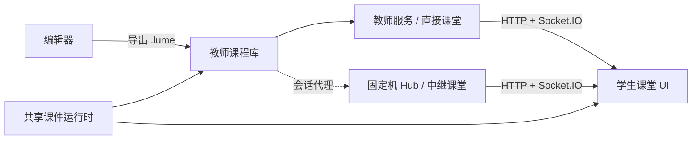

# 当前系统架构

更新：2026-09-27。教师、学生和 Core 已并入根仓，目录对应关系见[源码迁移记录](/status/submodules)。本页描述当前模块位置；未完成的行为迁移见[实施 TODO](/status/todo)。

## 工作区结构

| 目录 | 职责 |
| --- | --- |
| `apps/teacher/desktop` | 跨平台 Electron 教师壳，现阶段运行本机直接模式 |
| `apps/teacher/ui`、`apps/teacher/server` | React 教师界面与现有课程/课堂 HTTP、Socket.IO 服务 |
| `apps/teacher/session-agent`、`apps/teacher/native` | 中继/直接模式客户端与旧 Windows WebView2 壳 |
| `apps/student/desktop`、`apps/student/ui` | Windows WebView2 壳及学生课堂/本机页面 |
| `apps/classroom-hub/server`、`apps/classroom-hub/projector` | 直接/中继课堂 Hub 和固定机只读投影页 |
| `apps/editor/app` | Electron 编辑器、UI、文件服务与模型 Agent |
| `packages/course-runtime` | 从 Core 导入的渲染和通用运行能力，包名暂为 `@lumesync/core` |
| `packages/*` 其他包 | 课堂协议、课件格式、组件模型/扩展和原生/平台契约 |

`pnpm-workspace.yaml` 管理上述 JavaScript 包；学生与旧教师 Windows 原生壳仍由各自 CMake/NSIS 脚本构建。文档站位于 `docs-site/`，下载站位于 `website/`。

## 当前课堂数据流

直接模式仍依赖现有教师服务；中继 Hub 与会话代理已有独立测试，但教师桌面 UI 尚未接入该路径。现有 Core 的旧 TSX/JS 播放分支仍使用 Babel 和页面内执行；目标的隔离播放器尚未实现。具体身份、状态与风险见[当前运行机制](/architecture/runtime-mechanisms)、[功能清单](/reference/features)和[目标架构](/architecture/target-architecture)。
