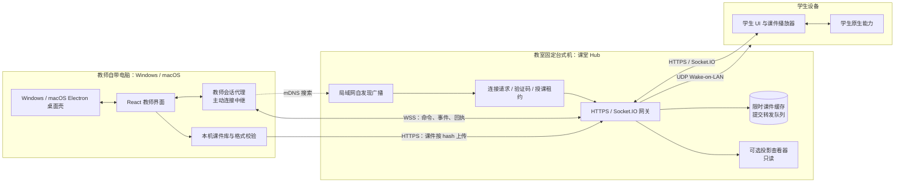
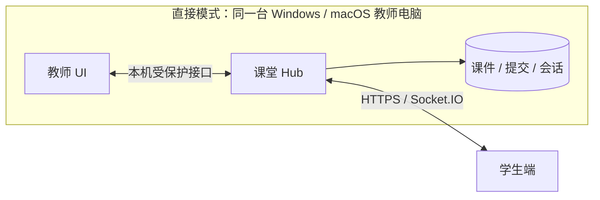
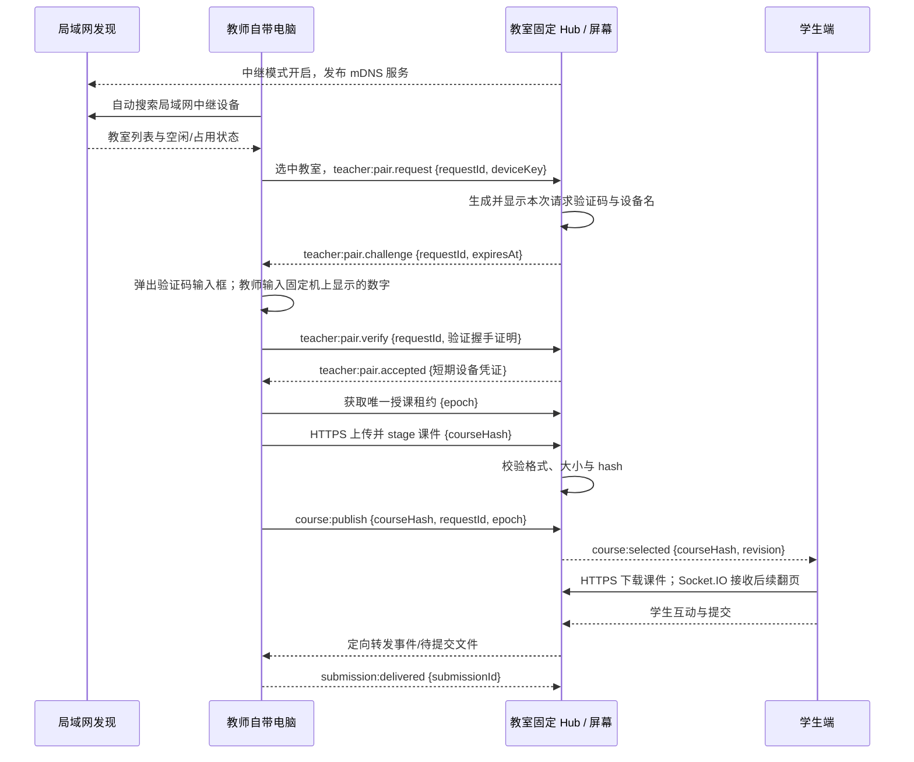

# 跨平台教师端与教室中继模式设计

状态：目标架构设计，macOS Electron 教师端已有第一阶段直接授课预览，中继桌面接入尚未完成。基于 2026-09-25 的源码评估。本文细化[三端目标架构](/architecture/target-architecture)中的教师端；旧 AI Editor 与 VS Code 插件均不进入目标架构。Windows 旧端仍为 C++20/Win32/WebView2；跨平台新端采用 Electron 复用现有 React 教师界面。

> 已实现部分：[共享契约包](/reference/contracts)、`apps/classroom-hub`、`apps/teacher/session-agent` 与 [Electron 教师端预览](https://github.com/yc004/SyncClassroom/blob/main/apps/teacher/desktop/README.md)。预览在 macOS 上加载现有教师界面并经本机课堂协议实测；中继模式的发现、配对与租约尚未接入桌面壳。下文其余协议与流程描述的是目标行为。

## 1. 目标与边界

教师端在 Windows 和 macOS 上复用同一套 React 界面、课件格式和课堂协议。Electron 提供跨平台桌面宿主；Windows 旧 WebView2 壳在过渡期继续使用。教师可以用两种方式授课：

| 模式 | 教师设备 | 教室固定台式机 | 学生连接地址 | 课件与授课控制权 |
| --- | --- | --- | --- | --- |
| 直接模式 | Windows 或 macOS 电脑同时运行教师应用与课堂服务 | 不需要 | 教师电脑的课堂地址 | 教师电脑 |
| 教室中继模式 | 教师自带 Windows 或 macOS 电脑运行教师应用 | 常驻教室中继服务，负责接入、转发、临时缓存与可选被动投影 | 固定台式机的稳定地址 | 教师自带电脑；中继只执行已授权的课堂命令 |

中继模式下，学生仍连接固定台式机，不需要知道教师自带电脑的 IP，也不需要随教师换电脑修改配置。教师端主动连接中继，因此无需在自带电脑上开放入站端口。用户在教师应用中搜索局域网内开启中继模式的设备，选中教室并请求连接；固定机显示本次请求的验证码，教师电脑弹出输入框。输入正确后建立授权会话并取得授课控制权，不再要求固定机额外点击“同意”。教室固定台式机不创建、编辑或主动选择课程，不代替教师作授课决策。为保证断线和提交可靠性，中继可以保留**有期限的传输缓存和待转发队列**；这不意味着固定台式机成为课件或提交的长期所有者。

## 2. 核心拓扑





两种模式共用同一个 `Classroom Hub` 协议实现。直接模式将 Hub 与教师应用部署在同一设备；中继模式把 Hub 部署在固定台式机。这样不需要维护两套选课、翻页或学生通信逻辑。

## 3. 推荐实现分层与跨平台选择

```text
apps/teacher/
  desktop/                # Electron 主进程、受限 preload 与跨平台打包
  ui/                     # 现有 React/TSX 教师界面迁移
  session-agent/          # 直接/中继模式的连接、上传、重连与命令客户端
apps/classroom-hub/
  server/                 # Node.js + Express + Socket.IO；教室稳定入口
  projector/              # 可选只读投影界面
packages/
  classroom-protocol/     # 命令、事件、角色、版本、回执 schema
  course-format/          # .lume 解析、校验、hash 与迁移
  course-runtime/         # 教师、学生、投影共用的受限播放器
  teacher-platform/       # 文件选择、导入导出、日志、窗口等抽象接口
```

**新教师端使用 Electron。** 当前预览在 macOS 上直接加载现有 React 教师界面，主进程启动本机 Node.js 教师服务；受限 `preload` 向页面提供文件、窗口和本机会话接口。后续将 `session-agent` 接入桌面主进程，覆盖中继搜索、验证码配对、租约与提交回执。Windows 旧 WebView2 壳在功能迁移期间保留。`teacher-platform` 继续作为能力契约，后续把页面里直接调用的旧接口逐步迁移到该接口。macOS 文件授权、应用签名与公证纳入发布验收。

教师 UI 的网络访问也必须经过 `ClassroomConnection` 抽象：直接模式指向本机 Hub，中继模式指向配对后的固定 Hub。现有 `fetch('/api/...')` 和 `window.io()` 默认同源的写法需要迁移为统一客户端，负责服务地址、身份凭证、协议版本、重连和错误处理；界面组件不自行拼接 Hub URL。这样桌面应用可以从本地打包资源加载 UI，同时连接远程教室。平台 API 保持与业务 UI 分离，将来增加 Linux 桌面包不应要求改写课堂业务层。

不把桌面容器与课堂服务绑定为一个进程。直接模式由桌面主进程启动本机 Hub 子进程；中继模式教师电脑只运行桌面应用与会话代理，固定台式机运行 Hub。Hub 本身使用跨平台 Node.js；固定台式机即便继续是 Windows，也不把 Windows API 写入 Hub 的课堂业务层。Wake-on-LAN 和投影等设备能力通过部署端适配器实现。

## 4. 功能保留与职责归属

现有教师 UI 与服务可从源码确认课程/文件夹管理、导入导出、课堂布局、选课与翻页、同步设置、批注、投票、学生在线/日志、截图监看、设备电源控制、作业提交与下载等入口。下表给出目标归属，不把新增模式误写为已实现。

| 功能 | 直接模式 | 教室中继模式 |
| --- | --- | --- |
| 课程列表、文件夹、导入、删除、导出 `.lume`/PDF | 教师电脑长期保存，Hub 从本地库读取 | 教师电脑长期保存；只把选中的课件版本上传到中继的限时缓存；删除本机课件不直接删除课堂已在用的缓存 |
| 座位表与教室布局 | 保存在教师电脑的本机 Hub | 教室座位与设备映射保存在固定 Hub，属于教室配置；教师可在授权后编辑，个人偏好仍留在自带电脑 |
| 选课、翻页、结束课堂、同步与全屏设置 | 教师 UI 发命令给本机 Hub | 教师 UI 通过 WSS 发命令到教室 Hub，Hub 校验租约后广播给学生 |
| 批注、投票、学生互动 | Hub 维护当前课堂事件与状态，教师 UI/学生端实时同步 | 教室 Hub 中转并保持课堂快照；教师电脑消费事件并展示结果；只允许当前授课教师发控制命令 |
| 学生在线、异常日志、截图监看 | 学生数据到本机 Hub，再送教师 UI | 学生数据先到固定 Hub，再定向送当前教师 UI；截图限流，不长久留在固定台式机 |
| 学生开关机/重启、远程唤醒 | 命令由本机 Hub 定向转发；Wake-on-LAN 由与学生同局域网的 Hub 发包 | 命令由固定 Hub 定向转发；固定 Hub 发 Wake-on-LAN，学生壳二次校验关机/重启请求 |
| 提交与批量下载 | 学生传到本机 Hub；最终保存到教师指定目录 | 固定 Hub 先有上限地落盘排队，转发到教师电脑并取得**最终保存回执**；教师 UI 才显示为“已收取”，随后可下载/导出 |
| 教室大屏 | 教师电脑本地显示或外接屏幕 | 固定台式机可运行只读投影查看器，跟随课堂状态，不出现管理员控制按钮；也可用教师电脑直接投屏 |
| 教师设置与日志 | 教师电脑本地保存；课堂设置同步给 Hub | 教师个人设置在自带电脑；教室连接配置在固定台式机；会话设置通过 Hub 同步 |

**提交可靠性约束**：学生端提交成功需要区分“中继已接收”和“教师电脑已保存”。教师离线时中继可以排队，但只有教师电脑确认落盘后才给出最终成功状态。中继队列需要容量、过期时间、加密与清理策略；达到容量时应明确拒绝新提交，不能静默丢弃。教师离开前，应用显示待同步数量并支持确认导出/清空，避免把作业长期留在教室机。

## 5. 局域网自发现与验证码接入

### 5.1 用户看到的流程

1. 教室固定机由管理员开启“中继桥模式”，屏幕显示教室名称、连接状态和“等待教师连接”。只有此模式开启时设备才发布发现服务。
2. 教师在 Windows/macOS 应用中选择“连接教室”。应用自动搜索局域网，在列表中显示教室名称、设备标识、地址、协议兼容性与“空闲/授课中”；教师选中目标设备并点击“请求连接”。自动搜索失败时可手动输入固定机地址，但后续验证码流程完全相同。
3. 固定机收到请求后显示**本次请求专用**的验证码和请求设备名称；教师电脑同时弹出验证码输入框及相同的教室名称、请求编号。验证码只出现在固定机屏幕，不由发现报文或网络响应返回。
4. 教师把固定机屏幕上的验证码输入自己电脑。验证成功后，教师应用显示“已连接到某教室”，固定机显示当前授课教师/设备；随即取得唯一授课租约。验证失败时保留输入框并显示剩余尝试次数；超时可重新发起请求。
5. 教师结束授课时主动断开。固定机回到“等待教师连接”，学生端保持原有固定机地址。

验证码输入正确就是本次接入的授权动作，不再增加固定机上的人工批准按钮。固定机保留“取消本次请求”和“撤销当前连接”入口，供设备主人处理误请求或异常会话。若固定机没有可用的交互屏幕，服务应明确返回“无法显示验证码”，而不是绕过验证。投影屏可能向全班显示验证码，因此验证码必须绑定**发起请求的设备与本次请求**，旁人不能拿它给另一台设备配对。

### 5.2 发现协议与状态

推荐用 mDNS/DNS-SD 发布 `_lumesync-relay._tcp.local` 服务。TXT 仅包含教室显示名、稳定设备 ID、协议主版本、连接端口和空闲/占用状态；不发布验证码、教师凭证或学生数据。教师应用按兼容版本过滤并合并重复网络接口的结果。发现报文只作设备列表，不能作为身份或授权依据。校园网若隔离组播/跨 VLAN，用户可手动输入地址，学校也可配置受管的教室目录；自动发现仍是默认入口。

| 固定机状态 | 发现列表 | 请求行为 |
| --- | --- | --- |
| 中继模式关闭 | 不发布服务 | 不接收远程教师配对 |
| 等待连接 | 显示“空闲” | 接收一个待验证请求并在固定机显示验证码 |
| 验证中 | 显示“正在连接” | 同一教室只保留一个活动验证码；其他请求排队或明确拒绝 |
| 已连接授课 | 显示“授课中” | 不产生新验证码；需现任教师释放租约或固定机管理员显式撤销后交接 |
| 网络/屏幕不可用 | 显示具体错误或从列表消失 | 不静默降级为无验证码连接 |

验证码建议使用密码学安全随机数生成的 **8 位数字**，有效期 3 分钟、每次请求最多 5 次输入，成功/过期/取消后立即失效。精确时长和次数应做配置与可用性验证；服务端必须限速，失败次数不能通过重新建 Socket 重置。验证码在 Hub 内按请求 ID、设备公钥和教室 ID 绑定；只保存验证所需的短期状态，不记入普通日志。首次接入需使用经过审查的密码学配对实现完成密钥确认并绑定后续 TLS 会话，不能单靠未验证的发现结果或明文传输验证码建立身份。成功后签发绑定设备身份、短时有效的教师凭证；**授课租约仍需单独获取**。

## 6. 通信协议

| 路径 | 建议传输 | 消息/数据 | 说明 |
| --- | --- | --- | --- |
| 固定 Hub → 局域网 / 教师应用搜索 | mDNS/DNS-SD | 教室名称、设备 ID、协议版本、地址与占用状态 | 只发现可用设备，不携带验证码和授权信息 |
| 教师应用 ↔ 教室 Hub | TLS 上的 Socket.IO（WSS） | 配对、租约续期、课堂命令、学生事件、状态快照和回执 | 教师应用主动发起连接；断线自动重连，不以 IP 推断 host 身份 |
| 教师应用 → 教室 Hub | HTTPS，分块或可恢复上传 | 已校验的 `.lume` 文件、hash、大小、格式版本 | 上传完成并校验 hash 后才能发布课程；Hub 分发缓存，不修改课件 |
| 学生端 ↔ 教室 Hub | HTTPS + Socket.IO（WSS） | 页面与课程资源、课堂事件、互动、设备命令 | 学生始终只连固定地址；直接模式改连教师电脑地址 |
| 教师 React 页面 ↔ Electron 主进程 | 受限 `preload` IPC，类型化请求/响应 | 文件、窗口、本机会话与设置 | 页面不直接获得 Node.js 权限；当前预览尚需逐项回归旧平台能力 |
| 固定 Hub → 学生网卡 | UDP Wake-on-LAN | 标准魔术包 | 仅远程唤醒；关机/重启走已授权的实时通道 |

课程资源采用**发布快照**：教师电脑计算包 hash `courseHash`，上传到 Hub；Hub 对学生发布 `{courseId, courseHash, runtimeVersion}`，学生按 hash 下载并缓存。教师电脑修改课件后生成新 hash，不能悄悄覆盖正在播放的版本。发布完成前，旧版本继续播放；缺少缓存或校验失败时拒绝切换并提示教师。

中继模式协议建议增加：

```text
teacher:pair.request   教师电脑提交设备公钥与请求 ID；固定机生成并显示验证码
teacher:pair.challenge 固定机返回请求编号、时限与配对握手参数，不返回验证码
teacher:pair.verify    教师电脑用输入的验证码完成本次请求的验证握手
teacher:pair.accepted  验证成功后签发绑定设备身份的短期会话凭证
teacher:lease.acquire  获取当前课堂的唯一授课控制租约
teacher:lease.renew    定时续租；每条控制命令带 leaseId + epoch
course:stage           上传校验完成后的课件版本，返回 courseHash
course:publish         以已 stage 的 courseHash 切换课堂课程
classroom:command      选课、页码、设置、批注清除等类型化命令
classroom:snapshot     教室当前课程、页码、设置、成员与 revision
student:event          学生互动、监看、日志、提交状态的定向转发
submission:delivered   教师电脑确认提交已落盘，Hub 才释放队列副本
teacher:lease.release  教师主动结束授课并释放控制权
```

每条消息使用 `protocolVersion`、`classroomId`、`sessionId`、`requestId`、`epoch`、`revision`、`payload`；由共享 `classroom-protocol` 包校验 schema。`requestId` 用于幂等去重，`revision` 用于学生重连后的快照同步，`epoch` 防止旧教师在租约切换后继续控制课堂。事件名是**建议契约**，不是当前 `server/src/socket.js` 已支持的协议。

## 7. 接入、交接与断线流程



**控制权规则**：一间教室同一时刻只能有一个授课控制租约。验证码验证成功后，仅在教室空闲时自动授予该请求的授课租约；固定机管理员可以取消待验证请求、撤销租约和强制结束会话，不能在 BYOD 授课期间暗中与教师电脑同时控制。另一位教师接入时必须先由现任教师释放或固定机管理员显式撤销，旧租约失效并提高 `epoch`。教师设备记忆教室身份，不能仅靠同网段自动取得 host 权限。

| 情况 | 目标行为 |
| --- | --- |
| 教师电脑短暂断网 | 学生继续显示最近已发布的课件和页码；Hub 暂停接受新的教师命令，继续收学生事件并限时排队；教师重连后以快照恢复 |
| 教师电脑长时间离线 | 租约过期，课堂进入“等待教师”状态；不自动把固定机升级为教师；管理员可结束或显式交接 |
| 固定 Hub 重启 | 按持久化的 `sessionId`、课件缓存和待提交队列恢复；客户端重连请求快照；未确认命令按 `requestId` 去重 |
| 教师电脑退出/正常交接 | 停止新提交，排空队列并核对最终回执，释放租约；清理缓存遵循保留策略 |
| 教师电脑与固定机同时断开 | 学生显示明确的连接中断状态；本地暂存允许的互动数据，恢复后按协议重试，不虚报已提交 |
| 上传课件失败或版本不兼容 | Hub 拒绝发布，课堂保持上一个可用课程；教师看到具体原因 |

## 8. 信任、安全与部署要求

1. **配对**：请求到达后固定机显示 8 位一次性验证码，教师只在自己的电脑输入。验证绑定请求、设备与教室；不再要求固定机额外点击批准。验证码不直接充当长期 host token，成功后换取短期设备凭证。固定机显示当前教师、课程和会话，并提供取消/撤销入口。
2. **传输**：局域网也用 TLS；首次配对的验证码验证应把教室身份、设备密钥与信道绑定，防止伪装的发现结果窃取课件和学生信息。证书分发方式需结合学校是否完全离线确定。
3. **权限**：Hub 对 HTTP/Socket 每条写入与控制命令核验角色、`classroomId` 和租约。当前公开发放 host token、IP 回退为 host 的路径必须在开放中继接入前淘汰。
4. **内容**：Hub 校验 ZIP 路径、大小、压缩比、manifest 和 hash；课件运行在隔离环境，不能直接调用 Electron IPC、WebView2 桥或学生原生能力。
5. **数据**：课件缓存与提交队列分别设置容量、过期和加密策略；教师个人课件和最终提交默认留在教师电脑。教室固定机管理员有清理/导出异常队列的受控流程。
6. **网络**：默认 mDNS/DNS-SD 自动发现，手动地址和受管目录是组播不可达时的补充；发现只帮助定位，不代替验证码验证。固定机开放经配置的课堂端口，教师电脑只需出站访问。

## 9. 与现有架构的差距与实施顺序

当前 `repos/teacher/native/shell`、`scripts/start-native.js` 和 Windows 打包脚本仍绑定 `.exe`、CMake/MSVC/PowerShell。`apps/teacher/desktop` 已实现 Electron 源码预览，复用 `window.teacherHost`/`window.electronAPI` 的现有调用点；正式安装包和完整能力回归仍待完成。教师服务的课程、布局、提交主要由本机文件路径和进程内变量管理，不能直接当作跨设备中继服务使用。安全加固现状详见[迁移状态](/status/migration)。

| 阶段 | 交付物 | 验收 |
| --- | --- | --- |
| 1. 抽离平台能力 | `teacher-platform` 接口、React UI 与文件/窗口 API 解耦；现有 Windows 模式仍可运行 | 现有授课功能回归测试通过 |
| 2. 跨平台直接模式 | Windows/macOS 桌面包，共享 UI，Hub 本机子进程，构建期静态资源 | 两系统均能导入课件、连学生、翻页、批注、监看、控制设备、收提交与导出 |
| 3. 提炼 Hub 与契约 | 状态中心、身份/授权、协议版本、快照、持久化队列、课件 hash 分发 | 一套协议同时支持本机和远程 Hub；断线重连与旧命令去重通过 |
| 4. 教室中继模式 | 固定机 Hub、mDNS 自发现、请求触发的固定机验证码、教师电脑输入验证、唯一租约、课件暂存、提交转发、可选投影 | Windows/macOS 均能搜索教室、完成验证码连接和断开；错误码/超时/占用均有明确反馈，学生配置不变 |
| 5. 发布与运维 | 双系统签名包、固定机安装/升级、证书与教室身份管理、日志和备份 | 冷启动、固定机重启、教师断网、交接、存储满额均有可预期结果 |

不先把现有 Windows 壳“兼容编译”到 macOS；跨平台入口应先从业务 UI 与系统 API 解耦，再建立单一桌面宿主和单一课堂协议。本文确定的是设计方向，尚未修改业务代码。
