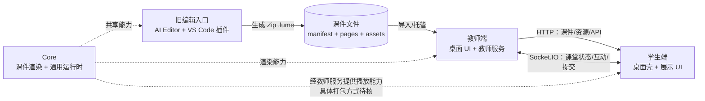
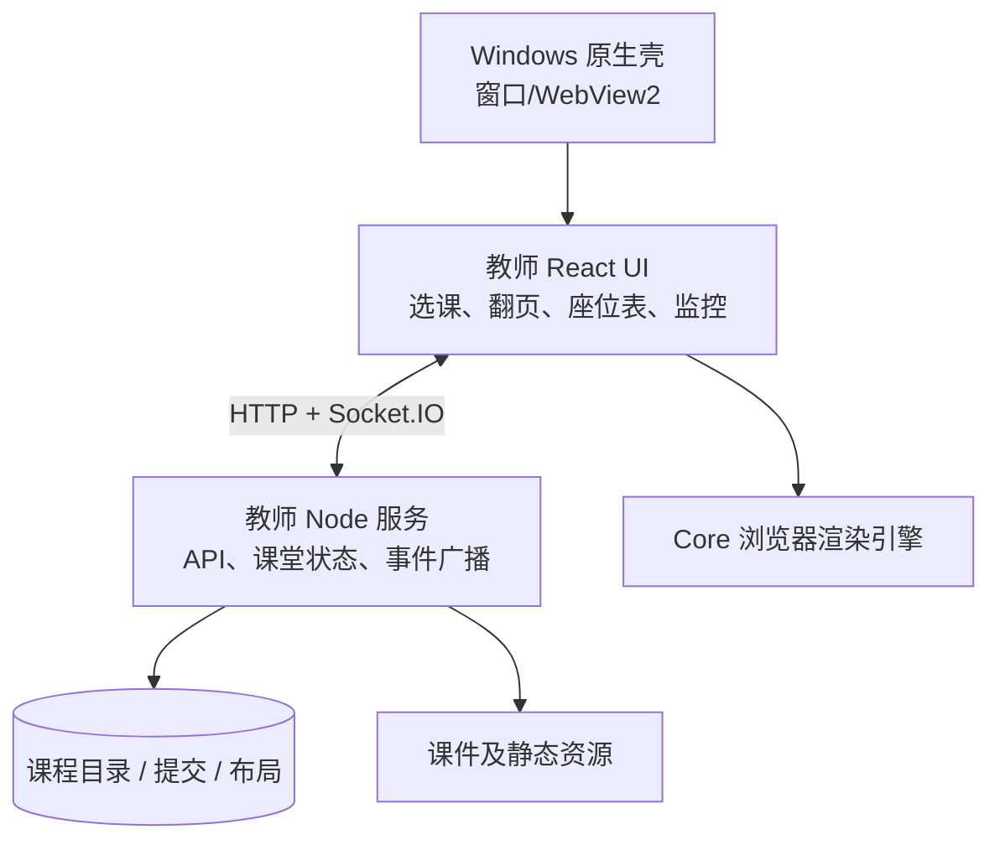
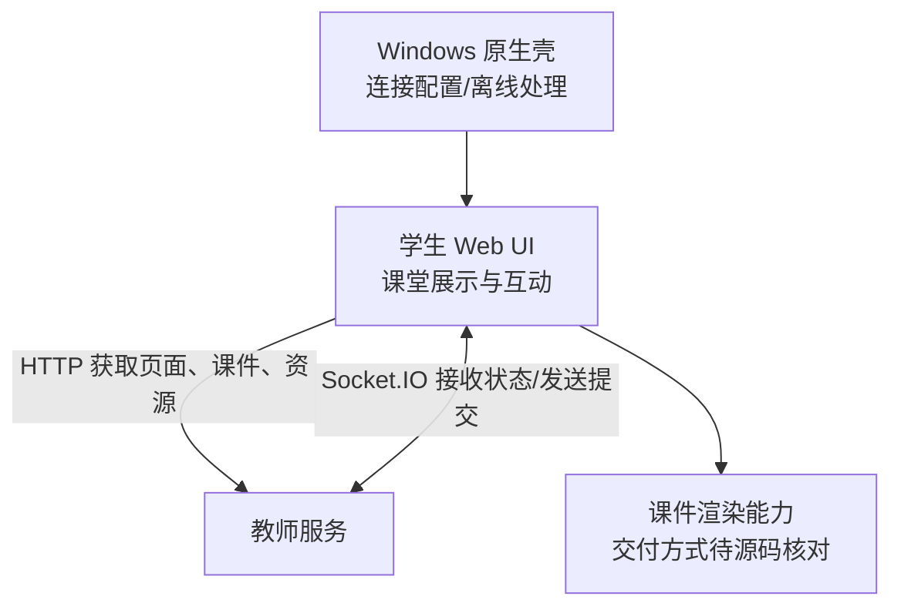
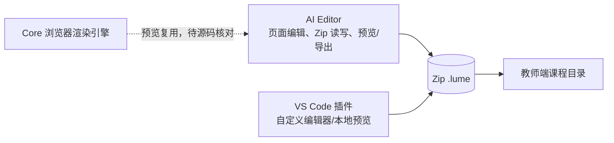
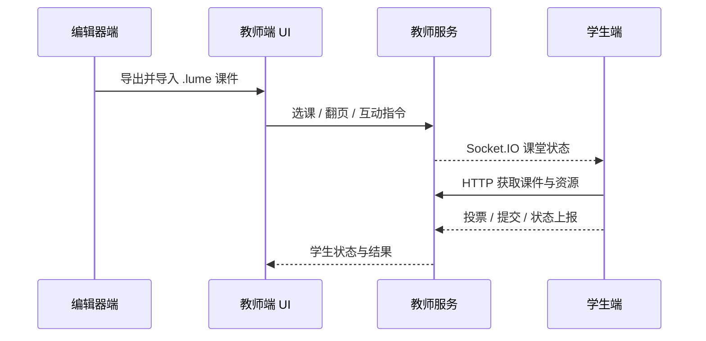

# 教师端、学生端、编辑器：三端架构

> **现状图（2026-09-25）**：本页记录旧项目结构，不代表目标架构。教师端和遗留 VS Code 插件已取得锁定源码；学生端和 Core 已取得当前远端源码，但锁定提交缺失；旧 AI Editor 未克隆。旧 AI Editor 和 VS Code 插件均已决定退出目标架构，详见[目标架构设计](/architecture/target-architecture)和[子模块状态](/status/submodules)。

## 一句话概括

**编辑器生产课件，教师端托管课件并控制课堂，学生端连接教师端消费课件和参与互动。** Core 是被多个流程使用的渲染/运行时能力；下图出现的 VS Code 插件仅是旧实现的一部分。

## 产品视角



课堂运行时，教师端是内容和课堂状态的中心。编辑器不直接参与正式课堂连接，学生端不管理教师机的课程目录。

## 三端内部结构

| 端 | 代码位置 | 现有文档描述的内部层次 | 主要输入 | 主要输出 |
| --- | --- | --- | --- | --- |
| 教师端 | `repos/teacher` | Windows C++/WebView2 壳；React 教师 UI；Node/Express + Socket.IO 服务；课程、提交及布局数据；`core` 运行时包 | `.lume`/PDF 课件、教师操作、学生事件 | 课程资源、课堂状态、提交结果与导出文件 |
| 学生端 | `repos/student` | Windows C++/WebView2 壳；连接配置与离线页；学生 Web UI；课堂展示与互动 | 教师机地址、HTTP 资源、Socket 事件 | 展示、投票/互动、提交、状态上报 |
| 旧编辑入口 | `repos/ai-editor` + `repos/editor-plugin` | 历史上分别承担课件读写/预览/导出与 VS Code 自定义编辑器、本地预览 | 页面代码、manifest、图片等资源 | Zip `.lume` 包；两者均不进入目标架构 |

### 教师端



文档站把教师服务称为完整课堂业务服务：课程扫描、API、Socket 同步、投票、标注、截图和提交都围绕它运行。独立 `start:core` 是通用 runtime 服务，不能代替教师服务。

### 学生端



学生端按既有设计是课堂状态消费者。连接失败、等待选课、播放课件是现有文档描述的典型状态。

### 编辑器端



两个旧编辑入口围绕同一种课件格式：`manifest.json` 描述页面和资源，`pages`/页面模块提供内容，`assets` 存储媒体。既有文档称 AI Editor 可在浏览器预览并导出，插件可在 VS Code 中编辑和预览。两者均不进入目标架构；本图保留它们仅用于解释既有系统。

## 从制课到上课的数据流



此图刻画的是职责与消息方向，不保证每一步都是单次请求。具体事件名、鉴权、ack、缓存和落盘行为应在子模块恢复后核对。

## 代码组织与产品概念的区别

```text
根仓：脚本、文档、文档站、下载站、四个 Git 子模块指针
├── repos/teacher/          教师端，内部含 core 工作区包
├── repos/student/          学生端
├── repos/ai-editor/        编辑器产品的浏览器应用
└── repos/editor-plugin/    编辑器产品的 VS Code 入口
```

因此是**三个产品端、四个 Git 子模块**。Core 在当前根工作区中引用为 `repos/teacher/core`，从职责上是共享能力，但物理位置在教师子模块内。这种“逻辑共享、物理内置”的关系可能影响后续架构优化，现阶段只记录现状，不预先决定拆分方案。

## 待源码确认的关键问题

1. 学生端究竟打包渲染引擎，还是完全使用教师服务提供的 bundle。
2. 新编辑器怎样与课件格式库、预览运行时共享契约，不依赖两个旧编辑入口。
3. 教师服务与独立 Core runtime 是否复用协议代码，是否存在两套身份与事件模型。
4. 教师端课程、提交和布局的持久化位置与备份方式。
5. 三端安装包的实际构建链、运行进程及版本兼容关系。

这些问题应作为下一轮源码审查的输入，再讨论架构优化。
