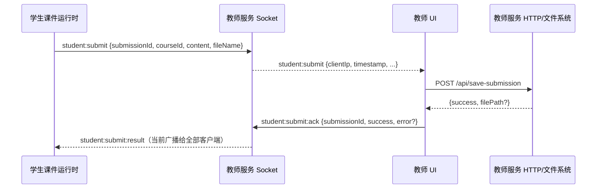

# Socket.IO 课堂事件协议

状态：**当前教师服务实现**，依据 `apps/teacher/server/src/socket.js`；Core 独立 runtime 另见文末。这里的事件名、字段和路由是源码现状，不是已完成类型化或版本化的公开协议。当前只做静态核对，跨端联调尚未运行。

## 连接、身份与房间

客户端使用 Socket.IO 连接教师服务的默认 namespace，通常由教师服务同端口提供 `/socket.io/` 握手。Socket.IO 可在 HTTP 长轮询和 WebSocket 间协商；事件 payload 是 JavaScript 对象/JSON 语义，**不是裸 WebSocket 自定义帧协议**。当前服务端 `pingInterval=5000ms`、`pingTimeout=8000ms`。

客户端可在 `handshake.auth`（或兼容性的 query）传入：

```js
{ role: 'host' | 'teacher' | 'viewer' | 'student', token: '...', clientId: '...', protocolVersion: 1 }
```

服务端将 `host`/`teacher` 归为 `host`，`viewer`/`student` 归为 `viewer`（归一规则来自[共享契约](/reference/contracts)）；按身份加入 `hosts` 或 `viewers` 房间，viewer 还加入基于 IP 的 `viewer-ip:<ip>` 房间。连接后依次发 `role-assigned`（兼容旧客户端，含角色、课程、页码、设置、目录、`protocolVersion`、`sessionId`、`revision`）、`session:accepted` 与 `classroom:snapshot`。教师端还收到初始 `student-status` 与 `student:screenshot:state`。

### 协议版本协商

| 情况 | 服务端行为 |
| --- | --- |
| 不带 `protocolVersion` | 按 legacy 客户端（版本 0）接受，`session:accepted.payload.legacy = true` |
| `protocolVersion` 等于当前版本（1） | 正常接受 |
| 版本号高于服务端支持，或不是非负整数 | 发 `protocol-rejected {payload:{code,message,protocolVersion,supportedVersions}}` 后断开 |

`session:hello` 是显式握手事件，任何已认证连接都可发送，服务端回 `session:accepted`（带权威 `sessionId` 与 `revision`），用于客户端在重连后确认服务端版本与状态代次。`classroom:snapshot` 仍是重连恢复状态的唯一权威来源；`request-classroom-snapshot` 可主动拉取。学生课堂页现在会应用快照：课程或页码与本地不一致时以服务端为准，`revision` 小于已见值的过期快照直接丢弃；教师页只记录权威 `sessionId`/`revision`（`window.__LumeSyncRevision`），因为教师端本身是命令发起方。

### 事件守卫

连接建立后，服务端按[契约事件表](/reference/contracts)挂载 Socket.IO 中间件：未声明的事件、角色不符的事件、payload 不符合 schema 的事件在进入业务处理器之前被拒绝。带 ack 回调的调用会收到 `{ok:false, code, message}`（`event_unknown` / `event_forbidden` / `event_payload_invalid`），没有 ack 的调用按 Socket.IO 中间件错误处理。业务处理器内原有的角色判断保留为纵深防御。

设置 `LUMESYNC_PROTOCOL_ALLOW_UNDECLARED=1` 可临时放行未声明事件，仅用于同网段旧客户端过渡窗口，不是默认行为。

教师服务现要求有效 host 共享 token 或绑定 `clientId` 的 viewer token；无效/缺失凭证触发 `identity-rejected` 并断开，已移除按 IP 回退角色。Core 独立 runtime 仍有自己的 legacy 兼容开关。当前 HTTP 只完成首轮 host 路由授权，课件与教师页面仍共享 JS 环境，不能因此把整个系统视为安全接入。见[HTTP API](/reference/http-api#教师服务会话与状态)与[迁移状态](/status/migration)。

## 教师服务事件总表

表中“发送方”是当前处理器要求的角色；`任何连接` 表示代码没有角色检查，**并非授权建议**。`→` 右侧说明服务转发目标，`socket` 表示只回发请求连接。未列出的 payload 字段一般被原样透传，不能假定服务端已做 schema 校验。

### 课堂控制与配置

| 入站事件 / 发送方 | 主要 payload | 服务端行为与出站事件 |
| --- | --- | --- |
| `get-student-count` / host | 无 | `student-status` → socket，`{count, action:'init'}` |
| `request-classroom-snapshot` / 已认证连接 | 无 | `classroom:snapshot` → socket，含 `sessionId`、递增 `revision`、当前课程/页码/设置 |
| `select-course` / host | `{courseId}` | 先缓存课件依赖；成功设置当前课程/页码 0 并 `course-changed` → 全部（含 `revision`），随后发快照；失败 `course-dependency-cache-error` → socket |
| `sync-slide` / host | `{slideIndex}` | 校验非负整数，更新页码；`sync-slide` → viewers（含 `revision`），随后发快照 |
| `update-settings` / host | 设置字段 | 合并 `currentHostSettings`，`host-settings` → viewers |
| `host-settings` / host | 设置字段 | 合并设置，`host-settings` → 全部；从关闭到开启 `syncFollow` 时补发当前页码给 viewers |
| `refresh-courses` / host | 无 | 扫描课程，`course-catalog-updated` → hosts `{courses:catalog}` |
| `end-course` / host | 无 | 清当前课程、页码、批注、相关投票和截图；`course-ended`、`host-settings` → 全部 |
| `register-dependencies` / host | `[{filename, publicSrc}]` | 写入服务端依赖 URL 映射，无回执；URL 目标策略尚未补齐 |
| `set-admin-password` / host | `{hash}` | `set-admin-password` → viewers `{hash}` |

当前主要设置字段包括 `forceFullscreen`、`syncFollow`、`syncInteraction`、`allowInteract`、`podiumAtTop`、`renderScale`、`uiScale`、加入/离开/退出全屏提醒、`monitorEnabled`、`monitorIntervalSec`。服务端把监看间隔限制在 0.5–5 秒之间。`uiScale`（教师端「课件页面缩放」）的有效上限是 1：1 已经等于把 1280×720 画布等比铺满可视区，再大就会被舞台的 `overflow-hidden` 裁掉课件边缘，因此渲染时会夹到 ≤1，教师端滑块区间是 80%–100%；`renderScale`（「课件内容缩放」）仍是 0.6–1.2，只缩放课件内部内容。设置是进程内状态，重启后的恢复不由此 Socket 模块保证。

### 学生状态、监看与设备控制

| 入站事件 / 发送方 | 主要 payload | 服务端行为与出站事件 |
| --- | --- | --- |
| `student-alert` / viewer | `{type}` | 记日志，`student-alert` → hosts `{ip,type}` |
| `student:screenshot` / viewer | JPEG data URL、`width`、`height`、`capturedAt` | 仅在监看开启时接收；校验前缀及最大约 1 MiB，`student:screenshot` → hosts；连接/关闭时还可能发 `:state`、`:clear`、`:reset` |
| `student:device-info` / viewer | `{mac, deviceName, clientId}` | 按 IP 更新座位设备信息，`student:device-info` → hosts；布局变化时 `classroom-layout-updated` → hosts |
| `student:power-control` / host | `{requestId?, action, targets...}` | `power-on` 在教师服务发 UDP Wake-on-LAN；关机/重启定向 `student:power-control` → 对应 `viewer-ip:<ip>` 房间；`student:power-control:ack` → 请求者 |
| `student:power-control:client-ack` / viewer | `{requestId, action, accepted, error?}` | 加上服务端 IP，转发给 hosts |
| `student-action` / viewer | `{type, slide}` | 记学生操作日志，无单独直接回执 |

`student:power-control` 接受 `power-on`、`shutdown`、`restart`、`force-shutdown`、`force-restart`。`power-on` 向广播地址的 UDP 9 和 7 端口发送魔术包；其回执代表发包尝试结果，不代表学生机器确实启动。其余操作经学生页面转给原生壳，`student:power-control:ack` 的 `success:true` 主要表示已向目标房间发送，设备执行结果应查看后续 `client-ack`。学生连接/断开按 IP 去重统计人数，`student-status` 的 `action` 为 `join`/`leave`，相应日志以 `student-log-entry` 发给 hosts。

### 状态同步与提交

| 入站事件 / 发送方 | 主要 payload | 服务端行为与出站事件 |
| --- | --- | --- |
| `request-sync-state` / viewer | `{courseId, slideIndex}` | 加 `requesterId=socket.id`，`request-sync-state` → hosts |
| `full-sync-state` / host | `{targetId?, courseId, slideIndex, state}` | 有 `targetId` 时定向到该 socket；否则发 viewers |
| `interaction:sync` / host | `{event, payload}` 等 | 仅 `syncInteraction` 开启时补当前课程/页码，转发 viewers |
| `sync-var` / host | `{courseId, slideIndex, key, value}` | 仅 `syncInteraction` 开启时原样转发 viewers |
| `student:submit` / viewer | `{submissionId, courseId?, content, fileName?, mergeFile?}` | 基本参数检查后加 `clientIp`/`timestamp`，`student:submit` → hosts；不直接落盘 |
| `student:submit:ack` / host | `{submissionId, success?, error?}` | `student:submit:result` → **全部连接**，而非只回原学生 |

#### 学生提交链路



学生 SDK 当前等待匹配 `submissionId` 的结果，超时 10 秒。服务端没有提交持久队列；教师 UI 未连接或 HTTP 保存失败会影响成功回执。结果广播给全部连接也暴露了不必要的结果范围。目标中继模式另设计暂存、转发和最终落盘回执，**当前尚未实现**。

### 投票与标注

| 入站事件 / 发送方 | 主要 payload | 服务端行为与出站事件 |
| --- | --- | --- |
| `vote:start` / host | `{voteId, question, options:[{id,label}], durationSec?, anonymous?}` | 以当前课程/页码开会话；时长裁剪到 10–300 秒；`vote:start` → 全部，初始 `vote:result` → hosts |
| `vote:submit` / viewer | `{voteId, courseId, slideIndex, optionId}` | 按 IP 防重复；`vote:submit:ack` → socket，`vote:result` → hosts；非匿名时也发 viewers |
| `vote:end` / host | `{voteId, courseId?, slideIndex?}` | `vote:end` → 全部，清理会话；超时定时器也会自动触发 |
| `annotation-add` / host | `{courseId, slideIndex, segment}` | 旧兼容事件，保存并向全部连接广播 |
| `annotation:segment` / host | 绘制中的片段 | 只转发 viewers，不存储 |
| `annotation:stroke` / host | `{courseId, slideIndex, tool, color, width, alpha, points}` | 保存完成的一笔并转发 viewers |
| `annotation:clear` / host | `{courseId, slideIndex}` | 删除当前页标注并转发 viewers |
| `annotation:get` / 任何连接 | `{courseId, slideIndex}` | `annotation:state` → socket，包含 `segments` |
| `annotation-load` / 任何连接 | `{courseId, slideIndex}` | 旧兼容查询，`annotation-loaded` → socket |

投票和标注都使用进程内 `Map`；每页标注数量默认上限 5000，超过后移除最旧片段。投票以 `courseId:slideIndex:voteId` 为键，学生投票去重键为 IP，不是设备 ID 或个人账号。服务器重启会丢失这些内存状态。

## Core 独立 runtime 服务

Core 的 `src/node/runtime-control.ts` 不是上述业务协议。它在连接时核验 host/viewer 身份，加入 `hosts`/`viewers`，发 `role-assigned` 与 `participant-joined`/`participant-left`；失败时发 `identity-rejected` 并断开。随后通过 `socket.onAny` 转发**除保留事件和仅服务端事件外**的任意事件：host 默认广播其他连接，viewer 默认转发 hosts；payload 里有 `targetId` 时定向到该 socket，并剥离 `targetId`。它不保存课程、投票或提交。`LUMESYNC_IDENTITY_LEGACY_COMPAT` 默认按源码为 `true`，可关闭；身份验证和失败码见 `packages/course-runtime/src/node/runtime-control.ts`。

## 协议限制与下一步

事件名、角色矩阵与 payload schema 现在由[共享契约](/reference/contracts) `packages/classroom-protocol` 单点维护，服务端在处理器之前统一校验；`protocolVersion` 已完成握手协商，快照带 `sessionId` 与递增 `revision`。

仍未完成：目标事件命名（`course:select`、`slide:set`、`submission:create` 等）只在契约里登记了映射，服务端仍发当前事件名，需要双发过渡窗口；命令级 `requestId` 幂等回执尚未铺开；`student:submit:result` 仍广播给全部连接而不是定向回执；课堂状态未持久化。教室中继模式所需的 `classroomId`、`epoch`（授课租约）字段已在信封中预留但未使用，详见[目标架构](/architecture/target-architecture)与[迁移状态](/status/migration)。
