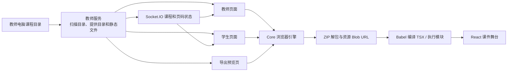
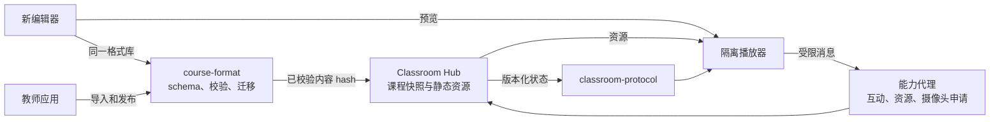

# 课件渲染架构评估与改进建议

状态：**2026-09-25 当前检出源码的静态审查 + 目标设计建议**。学生端和 Core 当前检出与根仓锁定指针不一致，尚未做教师/学生 Windows 实机联调。本文不把目标方案写成已实现能力。课件字段和 SDK 的现状见[课件格式与 SDK](../reference/course-format-sdk.md)，跨端总体设计见[三端目标架构](target-architecture.md)。

## 结论

现有职责划分基本合理：教师服务托管课程文件和课堂状态，Core 提供浏览器加载与播放，教师页面、学生页面和导出预览复用同一渲染引擎；PDF 也有独立播放分支。这个方向可以保留。当前实现还不能作为稳定的跨端课件运行时边界：课件脚本直接进入课堂页面的 JavaScript 全局环境，格式校验与版本协商过弱，加载/释放没有按“一个课程实例”管理。新编辑器、跨平台教师端和教室中继落地前，应先把格式、加载状态机、隔离播放器和能力 API 固定下来。

## 当前渲染链路

1. 服务端扫描 `.lume`、PDF 和脚本文件；ZIP `.lume` 只读取 `manifest.json` 的部分字段生成课程目录。选课后服务端广播课程 ID，教师、学生页面分别从 `/courses/...` 获取文件并调用 `engine.loadCourse`。证据：`repos/teacher/server/src/courses.js:95-106,151-168`、`repos/teacher/server/src/socket.js:358-393`、`repos/teacher/shared/teacher-shell/src/app.tsx:1042-1075`、`repos/teacher/shared/public/student-app.js:184-205,307-324`。
2. ZIP 分支在浏览器完整下载文件，用 JSZip 解包，生成资源 Blob URL，逐页用 Babel Standalone 编译 TSX，再以 `new Function` 执行并生成 React 元素；随后加载依赖脚本并建立课程上下文。证据：`repos/teacher/core/src/browser/engine/runtime/app.tsx:87-160,250-343,476-525`。
3. `CourseStage` 复用 `SyncClassroom` 播放舞台；PDF 用 pdf.js 将页面画到 Canvas；导出预览也调用同一 `loadCourse`，但使用一套禁用部分交互能力的上下文。证据：`repos/teacher/core/src/browser/engine/runtime/app.tsx:346-429,458-474,528-563,597-695`、`repos/teacher/shared/public/export-preview.html:548-565`。

这里的“复用引擎”是浏览器代码复用，并非课件在教师端编译一次后分发给学生。各客户端仍独立下载、解包、编译和执行。Core 的 `CourseStage` 同时包含播放、同步变量、标注、投票及部分教师工具栏；它还不是纯粹的渲染核心。

## 合理之处

| 设计 | 评价 |
| --- | --- |
| 课程文件与课堂状态分开 | 文件走 HTTP、翻页走 Socket.IO，符合两种数据不同的更新频率；目标架构可继续使用。 |
| 教师、学生和导出预览复用 Core | 减少三套播放器分叉；需要通过相同版本的引擎和格式契约保证结果一致。 |
| ZIP 包带 manifest 与资源目录 | 具备离线分发和内容寻址的基础；格式校验目前尚不够。 |
| PDF 单独适配为页序列 | 可以沿用同一课堂页码模型；PDF 缓存和画布尺寸仍需优化。 |

## 架构问题与证据

| 优先级 | 问题 | 影响与源码证据 |
| --- | --- | --- |
| P0 | 课件代码没有隔离边界 | `new Function` 在课堂页面执行，能访问 `window`、DOM、Socket 和页面上可见的原生桥；`require` 白名单只限制 import 名称，不能限制全局访问。第三方依赖又以 `<script>` 注入同一页面。`app.tsx:127-160,476-506,585`；`resource-loader.tsx:6-53`。将来即便换 Electron 壳，也必须独立限制课件 origin、进程和 IPC 能力。 |
| P0 | 服务端格式校验不足，发布前没有可播放性门禁 | 扫描时只确认 ZIP 特征、能读 manifest 且 `runtime.format` 匹配；播放器只要求非空 pages 与 `page.file`，不检查版本、路径、重复 ID、条目数量/解压后大小，也没有在广播选课前证明每页可编译。`courses.js:38-106,151-168`；`app.tsx:176-190,258-320`；`socket.js:358-381`。坏包可能在全班选课后各自失败。 |
| P1 | 加载顺序、并发与资源生命周期不完整 | 页面模块先编译和执行，`dependencies` 随后才加载；模块顶层若直接用依赖全局变量会失败。开始加载新包时先撤销上一包 Blob URL；错误路径没有统一的 finally 清理。教师和学生端的异步 `loadCourse` 未见请求代次或取消逻辑，快速切课可能使旧结果回写新课堂。`app.tsx:35-45,250-343,476-525`；教师 `app.tsx:1042-1075`；学生 `student-app.js:184-205,307-324`。 |
| P1 | 全局可变上下文跨课程共享 | `window.CourseData`、`window.CourseGlobalContext` 和 Object URL 列表挂在同一个页面全局；课件模块执行时上下文建立于之后，旧值可能仍可见。课程卸载并不等于脚本、副作用、事件监听与计时器被撤销。`app.tsx:35-45,127-160,276-343,523-525`。这是从实现推导的风险，需用切课与副作用测试确认具体表现。 |
| P1 | 资源依赖不具备可复现性 | 加载器在本地脚本失败时回退第三方 CDN，且课程可声明任意 `publicSrc`；失败结果没有被依赖加载循环作为硬错误处理。不同教室网络可能播放不同版本或缺失依赖。`resource-loader.tsx:6-53`；`app.tsx:490-507`。 |
| P2 | 资源与布局成本由每个客户端重复承担 | 每台学生机完整下载 ZIP、解包全部 assets、编译所有页面；资源 URL 一次性创建。PDF 文档 Promise 按 URL 缓存在全局 Map，当前未见淘汰；Canvas 按固定 1280×720 目标与设备像素比渲染。大课件和高 DPI 设备的内存、首屏时间需测量。`app.tsx:87-110,258-343,346-395`。 |
| P2 | 播放、课堂协议和导出模式仍交织 | `CourseStage` 包着含标注、同步、工具栏的 `SyncClassroom`；导出预览用禁用能力的假上下文，无法证明互动页的导出内容等同课堂播放。`sync-classroom.tsx:80-155,640-685`；`app.tsx:458-474,597-665`。 |

## 建议的目标边界

1. **`course-format` 是唯一的包契约所有者。** 明确 schemaVersion、最低/最高 runtimeVersion、页面 ID 和路径规则、资源 MIME/大小、依赖清单、内容 hash。编辑器导出、教师导入、Hub 发布和播放器加载调用同一校验器。保留旧脚本为显式迁移入口，不让其绕过新格式门禁。
2. **`course-runtime` 拆为播放器与宿主适配器。** 先定义 `prepare(courseBlob, runtimeVersion, signal) → preparedCourse`、`mount(container, context) → dispose()` 之类的生命周期契约；每个课程实例自己持有 Blob URL、脚本/Worker、监听器和缓存。`prepare` 完成所有版本、依赖与页面检查后才能替换正在播放的课程。加载失败保持上一可用版本并显示可诊断错误。
3. **课件在独立信任边界执行。** 优先评估声明式组件/受控交互模型；若继续支持任意 TSX/JavaScript，使用隔离 origin 的 iframe/独立 WebView 或等效进程隔离，配严格 CSP、资源来源限制和版本化 `postMessage` 能力 API。宿主校验消息来源、课件身份和操作权限；课件不能直接访问教师/学生页面、Socket 或原生桥。React 组件不能跨隔离边界直接共享，因此迁移前应先做包含 SDK、图像、视频、互动的可运行原型。
4. **发布不可变课件快照。** 教师端或 Hub 校验通过后按 `courseHash + runtimeVersion` 发布；学生按 hash 下载、校验并缓存。课堂状态引用明确版本，教师修改文件不改变正在播放的内容。中继模式按[教师端与中继设计](teacher-cross-platform-relay.md)的发布快照落地。
5. **课堂状态与课件状态分层。** 页码、当前课程版本由 Hub 唯一持有；课件内部临时状态经受控 SDK 同步。`CourseStage` 只负责版式、缩放和播放器容器；标注、投票、监看、教师工具栏归宿主 UI 或独立课堂插件。导出应声明可支持的页面能力，并用同一 `preparedCourse` 做静态快照。

## 分阶段改造与验收

| 阶段 | 最小交付 | 验收 |
| --- | --- | --- |
| 1. 固定现状 | 锁定教师/学生/Core 版本；建立 ZIP、PDF、互动、资源依赖样本；记录三端首屏、内存与切课行为 | 同一锁定版本可在 Windows 双机复现播放、翻页和导出，记录已知差异。 |
| 2. 格式与发布门禁 | 共享 schema/校验器；ZIP 数量、大小、路径、压缩比上限；显式版本错误；课程 hash | 坏包、旧版本和缺资源在发布前被拒绝；旧课程仍可播放。 |
| 3. 生命周期与可靠性 | 课程实例、AbortSignal/代次、依赖先加载、失败回滚、统一 dispose、PDF 缓存上限 | 快速切课、断网、缺依赖与失败重试不回写旧结果、不泄漏 URL/监听器。 |
| 4. 隔离播放器 | 隔离环境与最小 SDK 消息协议；逐步迁移页组件 | 课件无法调用宿主 DOM、Socket 或原生能力；既有互动样本在授权能力内运行。 |
| 5. 性能与一致性 | 预编译或按页编译、按需资源解包、hash 缓存、导出能力声明 | 教师/学生/预览渲染结果在固定样本上可比对，较大课件的加载与内存有预算。 |

上述验收是后续实施门槛，本文没有声称这些改造已完成。短期最应先做第 2、3 阶段的设计与原型，因为它们直接决定新编辑器产物能否稳定在教师、学生和中继模式播放。
