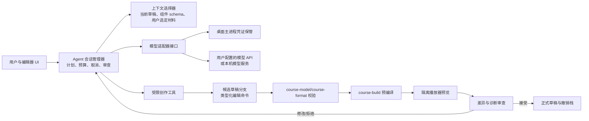

# 编辑器 Agent 与用户自带模型 API 设计

状态：**MVP 首轮已实现，完整设计仍待完成**（2026-09-26）。本文补充[新编辑器完整设计](editor-design.md)；AI 生成结果仍是同一种可编辑 `.lume`，不增加独立格式。`apps/editor` 已实现一个 OpenAI Chat Completions 兼容 API 适配、连接测试、取消请求、固定类型编辑命令、候选差异审查和 `safeStorage` 密钥保护。Agent 上下文现在包含当前课件锁定的自定义组件 ID 与 props schema，可在候选命令中选用这些组件；Agent 不能安装包或修改扩展锁。多供应商适配、流式输出、预算/用量策略、材料授权、来源引用和多阶段页纲审批仍是目标设计。旧 AI Editor 不作为实现基础。

## 目标与边界

Agent 是编辑器中的**课件创作协作者**：可以根据主题、教学目标、受众和用户提供的材料，拟定大纲、创建页面、选用已安装组件、导入资源、设置主题、提出代码组件草案，并根据构建和预览诊断修订。用户始终能够检查、撤销和继续手工编辑其改动。Agent 不持有课堂 host 凭证，不直接发布课件，也不能绕过格式/组件校验。

第一版优先支持：

1. “从主题/教学目标生成课件”：先给出页纲和估计页数，用户可修改后生成草稿。
2. “根据材料生成”：用户明确选择文档、图片或文本，Agent 引用这些材料生成页面，并标记来源与尚待核实的内容。
3. “修改选中范围”：润色、扩写、缩短、翻译、换主题、增加测验或把文本改成图表等。
4. “诊断并修复”：读取 schema、构建和预览错误，提出最小编辑命令，再重新验证。
5. “高级模式”：生成 TSX 代码页或自定义组件源码，但只进入待审查分支，必须构建并在隔离预览中运行；不能自动安装有高权限的插件。

教学事实、题目答案、版权和引用仍由作者负责审核。界面应显示“AI 生成/待核实”标记与引用出处；没有来源时不制造引用。自动生成的资源在导入课件前记录来源、许可或用户提供状态。

## 架构决策



**模型只提出操作，编辑器执行操作。** 模型输出不能直接写项目文件、改 manifest、运行 shell 或调用教师/Hub API。Agent 的每个编辑工具都校验参数、目标节点、组件 props、资源引用和草稿 revision。所有 Agent 改动先应用到候选草稿分支；用户一次性审查、接受或拒绝，接受后形成一个可撤销事务。对于很长的生成任务，可按“页纲”“内容”“视觉完善”形成多个检查点，用户逐步接受。

Agent 会话管理器、模型网络请求和凭证保管运行在桌面主进程或独立服务进程；UI 只通过受限 IPC 请求会话、接收流式状态与差异。Agent 与课件播放器、组件插件不是同一扩展系统：插件不能读取用户的模型配置或复用 Agent 工具；如未来开放“AI 工具插件”，需独立的能力清单与授权。

这里的 `course-agent` 是**制课 AI Agent**，与已存在的 `apps/teacher/session-agent`（教师连接直接/中继 Hub 的会话客户端）职责完全不同。两者不共享凭证或工具接口。

## 用户 API 配置

设置页维护多个**模型配置档**，每档包含：显示名、提供商适配器、API 基址、模型 ID、认证方式、可选组织/项目参数、超时、并发上限、支持的能力和费用上限。用户选择默认档，也可为某次任务临时切换。第一版可提供通用 HTTP 适配器和本机模型适配器；具体供应商协议由独立适配器实现，不能假定所有“兼容 API”都支持工具调用、图像、结构化输出或流式事件。

```ts
interface ModelProviderAdapter {
  id: string;
  probe(profile: PublicProfile): Promise<ModelCapabilities>;
  generate(request: ModelRequest, signal: AbortSignal): AsyncIterable<ModelEvent>;
  estimateUsage?(request: ModelRequest): Promise<UsageEstimate>;
}

interface ModelCapabilities {
  text: boolean;
  imageInput: boolean;
  imageOutput: boolean;
  toolCalls: boolean;
  structuredOutput: boolean;
  streaming: boolean;
  contextLimit?: number;
}
```

这是目标接口示例。连接测试应只发送最小请求并显示模型返回、延迟和错误；能力探测可能不完整，允许用户修正配置，但执行时仍按响应做校验。若模型没有原生工具调用或结构化输出，适配器可要求返回受限 JSON 提案，再由本地 schema 验证；解析失败时反馈模型重试，不能把自由文本当作可执行命令。图像能力不存在时仅生成资源占位和建议，不能假装已有图片。

密钥存入操作系统受保护的凭证存储；配置文件只保存不含密钥的公开字段及凭证引用。只有网络请求进程可读取密钥，UI、课件预览、组件插件、导出包、日志和崩溃报告都不能获得它。API 基址默认要求 HTTPS；本机 loopback 模型服务可以明确选择 HTTP。自定义服务地址由用户输入并明确展示发送目标，不接受课件内容、插件或模型回复来更改。证书验证不可被静默关闭。编辑器也不应把学校/学生数据发送给模型，除非用户明确选择并确认该材料。

## Agent 的工具与权限

第一版工具是固定的类型化集合，按“读取上下文”和“提出修改”划分：

| 工具 | 能力 | 约束 |
| --- | --- | --- |
| `getProjectOutline`、`getPage` | 读取当前草稿结构与用户选定页 | 默认只提供摘要与选中页，避免发送整个项目。 |
| `searchComponents`、`getComponentSchema` | 查询已安装标准/自定义组件 | 返回 ID、版本、props schema、能力和示例；Agent 只能引用已解析且兼容的组件。 |
| `readSelectedAssets` | 读取用户同意上传给模型的文字/图片 | 默认只传资源元数据；逐项选择传内容并显示将发给哪个服务。 |
| `proposeEdit` | 提出创建/更新/移动/删除页面和节点 | 使用类型化编辑命令与草稿 revision 前置条件；删除等大范围改动在差异页醒目标示。 |
| `proposeAsset` | 导入用户材料、生成文本数据或引用外部生成资产 | 资源进暂存区，经大小、类型、来源和许可检查后才进入课件。 |
| `proposeCode` | 创建代码页/组件源码草案 | 高级模式；不能直接执行，须编译和隔离预览。 |
| `validateDraft`、`buildPreview`、`readDiagnostics` | 运行现有校验/构建/预览并读取诊断 | 只作用于候选草稿，限制次数、CPU/内存和总时长。 |

不提供任意 shell、任意文件系统、原始 Socket、教师会话代理、插件安装和课堂发布工具。Agent 不能通过“让模型输出某段代码”绕过这些权限；代码页仍按[隔离播放器设计](course-rendering.md)处理。自动修复最多迭代预设次数，达到预算、重复错误或取消时停止并保留候选分支与诊断。

## 一次创作任务的状态机

```text
配置检查 → 上下文/材料选择 → 页纲提案 → 用户调整
        → 候选分支生成 → 本地校验 → 预编译/预览
        → 差异审查 → 接受为正式草稿 / 继续修改 / 放弃
```

会话记录 `sessionId`、`baseDraftRevision`、模型配置档 ID、选定材料、授权范围、预算、工具调用及每次候选修订。状态为 `planning`、`generating`、`validating`、`needsReview`、`failed`、`cancelled`、`accepted`。用户取消或切换项目时中断网络请求与构建任务；旧 revision 的结果不能覆盖新草稿。网络断开时保留候选内容，用户可换模型重试。每次工具调用带 request ID，重复流式片段不会重复应用编辑命令。

**页纲审批是体验步骤，最终差异审查是写入门槛。** 用户可以选择自动生成多页候选草稿，无须批准每一处文字；正式草稿仍需用户接受候选差异。接受后任何手工编辑都与普通课件一样保存和导出；AI 会话不成为课件运行时依赖。模型输出的源代码、图片和文案不能绕过现有的保存、构建、发布门禁。

## 上下文、来源与提示注入

Agent 上下文分四类：系统内置的课件 schema/工具规范、编辑器当前草稿、用户明确选定的参考材料、模型生成内容。后面三类都按不可信数据处理。文档、网页、课件文本或组件说明中的“忽略之前规则”“调用某工具”等指令只能作为内容引用，不能授予工具权限。工具调用的合法性由本地权限表和 schema 决定，不由模型自述决定。

检索只索引当前用户打开的项目和明确加入的资料。每个生成段落可关联来源资源 ID、页码/段落位置与简短证据；无法溯源的事实标记为待核实。默认不把完整学生名单、提交、教师凭证、学校内部文档或课件全部资产放入模型请求。发送前显示材料列表、估计字数/图片数、模型服务地址及预计成本范围；用户可移除条目。日志只保留操作元数据和脱敏错误，完整提示词/响应的本地留存由用户设置且默认不上传。

## 费用、性能与失败处理

- 每个模型档可设置单次请求、单个任务与每日预算。任务开始前给出粗略估算；实际用量以提供商返回值记录，缺失时标“估算”。达到预算立即停止新请求，保留可审查候选分支。
- 上下文按页面/组件粒度摘要，优先发送需要修改的部分；同一资料摘要可按内容 hash 缓存，用户可清理。长课件分阶段生成，每段通过 schema 校验后再进入下一段。
- 网络错误、限流、格式错误、模型不支持工具调用分别给出可操作反馈；重试使用退避和请求 ID，不能重复追加页面。模型生成质量差时允许选择其他配置档重新生成某页，而不重做整课。
- 资源生成与代码生成设置独立预算。代码编译失败或预览异常时，只回传必要诊断，不把整个文件系统或敏感日志传给模型。
- 模型服务不可用时，手工编辑、组件库、预览、保存和导出仍可使用；Agent 是创作入口之一，课件播放不依赖模型 API。

## 模块归属与实施顺序

| 目标模块 | 职责 |
| --- | --- |
| `apps/editor/ui` | 已有 Agent/API 配置面板、创作提示词、候选计划和差异审查；材料授权、预算提示和流式状态仍待实现。 |
| `apps/editor/desktop` + `apps/editor/src/editor-service.cjs` | 已有单一 Chat Completions 请求、取消、系统安全存储和受限 IPC；任务恢复、分步状态和重试策略待实现。 |
| `packages/model-provider` | 待抽取；当前只有 editor 内的单一兼容适配，不含流式事件或多供应商能力探测。 |
| `packages/course-agent` | 待抽取；当前 `generateCourseCandidate` 只负责一次提案、类型化命令校验和本地候选分支。 |
| `packages/course-model` | 已实现文档校验、标准组件定义、命令/revision、撤销重做、候选审查、差异和静态编译。 |

第一步在课件数据模型中定义类型化编辑命令和分支/合并机制，并让手工 UI 使用同一命令入口。第二步实现一个文本模型适配器与受保护凭证配置，完成“主题 → 页纲 → 声明式页面草稿 → 差异接受”。第三步接入组件检索、材料引用、构建/预览诊断与可控重试。最后增加多模态资源和高级代码组件生成。验收重点是：无效模型输出不能修改项目；取消/断线/预算耗尽不损坏草稿；同一候选分支能一键接受或撤销；生成课件重开后仍可手工编辑；模型密钥不出现在课件、预览、日志或插件中。
