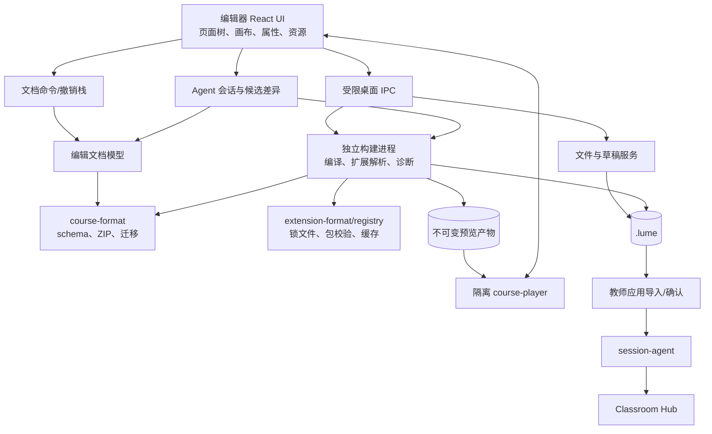
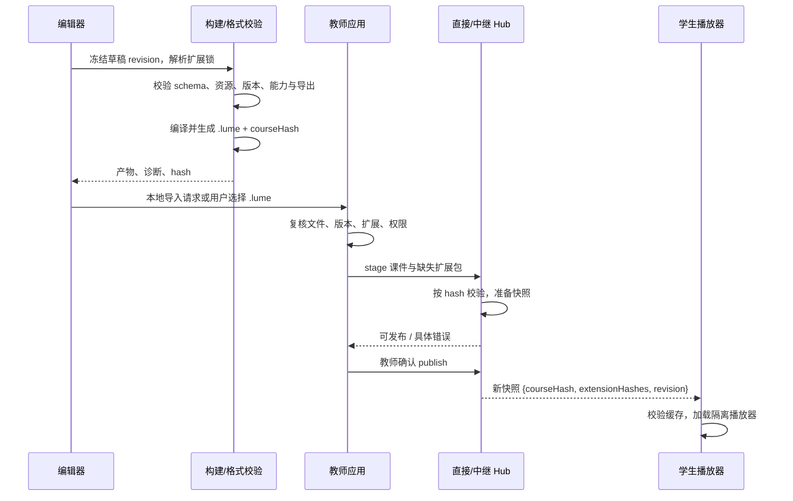

# 新课件编辑器完整设计

状态：**目标架构 + 编辑器与声明式组件首轮实现**（2026-09-26）。本文综合[三端目标架构](target-architecture.md)、[课件渲染评估](course-rendering.md)、[内容与扩展机制](course-content-extensions.md)和[教师端/中继设计](teacher-cross-platform-relay.md)。`packages/course-model`、`packages/component-extensions` 与 `apps/editor` 已实现声明式文档、四种标准组件、受限 `.lumex` 模板组件导入、锁定、编辑、`.lume` 离线封装、撤销/重做、Agent 候选审查和 Electron UI。任意代码扩展、资源插件、通用预编译器和隔离课堂播放器仍待实现；本文中的其余接口与目录是目标设计。

## 1. 产品定位与关键决策

编辑器负责**制作、编辑、预览、验证和导出课件**。教师应用负责**导入、选择并发布课件、控制课堂和接收学生数据**。两者共用格式库、组件契约和播放器，不共用 host 凭证或课堂控制 UI。旧 AI Editor 与 VS Code 插件可供迁移分析，不作为新编辑器代码基础。

第一版选择**独立的 Windows/macOS 本地优先桌面应用**，建议 Electron 宿主 + React/TypeScript UI + 独立构建进程。理由是需要可靠的本地文件、离线资源、ZIP 原子保存和用户组件构建；教师端目标也建议 Electron，能够复用平台适配和发布流水线。编辑器业务层不直接依赖 Electron：文件、对话框、构建与扩展安装通过窄接口调用，之后可增加浏览器版及远程工作区。桌面 renderer 开启 context isolation，不暴露 Node.js；课件预览在独立来源/隔离窗口。

| 决策 | 第一版约定 | 为什么 |
| --- | --- | --- |
| 默认创作 | 声明式页面树 + 标准组件 + 主题 token | 大多数作者无需写代码；属性可校验、迁移和可视化编辑。 |
| 高级创作 | TSX 代码页与自定义组件，保存源码，发布时预编译 | 保留复杂交互和外观的扩展能力；课堂端只播放确定产物。 |
| 工作文件 | 持久草稿工作区；`.lume` 同时保存源文件和构建产物 | 崩溃可恢复，已导出的 `.lume` 可以再次打开修改。 |
| 组件和插件 | 使用[扩展包协议](course-content-extensions.md)，按精确版本与 hash 锁定 | 官方和用户组件使用同一机制；离线课堂可复现。 |
| 预览 | 使用与课堂同版本的隔离播放器，提供教师、学生、导出三种上下文 | 预览结果可与课堂播放比对；不会把编辑器权限交给课件。 |
| 发布 | 先导出 `.lume`；教师应用确认后调用现有直接/中继会话代理 | 编辑器不复制课堂授权、租约和上传协议。 |

## 2. 用户流程与界面结构


### 2.1 主界面

| 区域 | 功能 | 关键交互 |
| --- | --- | --- |
| 项目首页 | 最近课件、模板、打开 `.lume`、恢复草稿 | 标明“草稿”“已保存”“已发布版本”；不把编辑中的内容直接覆盖课堂快照。 |
| 左侧页面树 | 页面、分组、组件层级和顺序 | 拖动排序、复制、隐藏、稳定 ID；批量更改有撤销点。 |
| 中央画布 | 16:9 课件视图、网格/吸附、编辑与预览切换 | 拖放组件、选中插槽、缩放只影响编辑器视图，不修改页面实际尺寸。 |
| 右侧属性面板 | schema 驱动的组件属性、交互、样式和辅助功能 | 必填、范围、资源引用实时校验；高级属性可查看原始 JSON。 |
| 资源面板 | 图片、视频、字体、数据文件 | 导入后复制入项目并分配稳定资源 ID；显示大小、引用页和缺失项。 |
| 组件与模板面板 | 官方、学校、个人组件；页面模板 | 显示包来源、版本、兼容性和所需能力；添加时写入依赖锁。 |
| Agent 侧栏 | 对话、页纲、材料选择、生成进度与候选差异 | 用户选择模型配置档和可发送材料；生成内容先进入候选草稿，审查后接受或放弃。 |
| 底部诊断 | 构建错误、兼容性、缺失依赖、导出限制 | 点击跳转页面/组件/属性；错误、警告分级，发布门禁明确。 |
| 发布面板 | 版本说明、文件大小、依赖/权限、预览结果 | 导出、交给教师应用、查看本次和上次包的差异。 |
| 设置 | 模型 API、费用预算、凭证、离线缓存和隐私偏好 | 模型密钥由桌面主进程保管；课件与插件不能读取。 |

标准页面模式先覆盖标题、正文、图片、音视频、图表、公式、布局、网页展示、投票和问卷。代码模式面向开发者，提供受控编辑器、类型提示、资源引用和构建诊断；不能让代码页依赖未声明的 `window` 全局变量。**Agent 是核心创作入口之一**：用户可接入自己的模型 API，由 Agent 生成大纲和候选页面、调用受限编辑工具、读取构建诊断，并在用户审查后把改动并入正式草稿。具体状态机、密钥与隐私边界见[编辑器 Agent 设计](editor-agent.md)；AI 产物仍经过同一 schema、构建和预览，不产生另一种课件格式。

### 2.2 可靠编辑

编辑操作生成可撤销命令；拖放、属性变更与资源替换按用户操作形成事务。草稿自动保存到用户数据目录，使用临时文件加原子替换；显式“保存课件”才重建并替换目标 `.lume`。打开已有 `.lume` 时先校验包并提取 `source/`；旧格式进入只读预览或显式迁移向导，迁移保存为新文件并保留原包。若外部程序改动同一文件，编辑器比较打开时的 base hash 与磁盘 hash，提示重新载入或另存，不能静默覆盖。

## 3. 数据模型与文件生命周期

`.lume` 仍是可交付的 ZIP 容器；新 schema 的版本号在实现时确定。课件的编辑源与播放产物均保存在包内：

```text
lesson.lume
├── manifest.json
├── extensions.lock.json
├── source/
│   ├── pages/*.json            # 默认声明式页面树
│   ├── code/*.tsx             # 可选代码页
│   └── theme.json
├── assets/*
└── build/
    ├── entry.js
    ├── styles.css
    └── build-manifest.json
```

唯一可人工编辑的事实源是 `source/`、`assets/` 与课件元数据；`build/` 是由这些输入、锁文件及指定编译器/SDK 版本确定的派生产物。`build-manifest.json` 记录输入摘要、目标 WebView/浏览器能力、工具链版本和产物摘要。打开课件时可以直接预览旧产物，但修改后必须重新构建；保存前若输入摘要与产物不一致，拒绝把旧 `build/` 作为新版本发布。详见[扩展包设计](course-content-extensions.md#可编辑课件与播放产物)。

页面采用稳定 ID 的组件树：节点包含 `type`、`props`、`slots`、可选布局约束和访问性说明。`type` 为命名空间组件 ID；props 遵循组件包 JSON Schema。资源引用使用包内逻辑资源 ID，由格式库解析成实际路径，不靠正则改写任意 JSX 字符串。组件临时状态不直接写入课件；需要课堂同步的状态通过版本化 SDK 和 Hub 事件契约表达。

项目草稿可以是应用管理的工作目录，不要求作者手动维护 ZIP。导出 `.lume` 时在临时位置完成完整构建与验证，通过后再原子替换目标文件。课程 ID 是逻辑标识；每次导出生成新的内容 hash，发布快照以 hash 区分版本。移动文件不应改变课程逻辑 ID。

## 4. 系统分层与进程边界



| 模块 | 职责与所有权 | 当前状态 |
| --- | --- | --- |
| `apps/editor/app/desktop`、`apps/editor/app/ui` | 桌面窗口、受限 IPC、编辑体验与草稿管理 | 已有 MVP：Electron sandbox/preload、标准组件表单、静态预览、页面管理、自动恢复、打开/保存。旧包尚不能导入编辑。 |
| `packages/course-format` | ZIP 读写、路径/大小限制、manifest 校验和内容 hash | 已有；编辑器复用包校验/打包，目前 authoring metadata 位于 v1 manifest 扩展字段。 |
| `packages/course-model`、`packages/component-extensions` | 文档 schema、标准组件、声明式组件包校验、props 表单元数据、扩展锁、静态预览与 TSX 兼容输出 | 首轮已实现；尚缺交互扩展 API、资源引用、代码页与真正预编译产物。 |
| `packages/course-build` | 依赖解析、静态分析、TSX/组件预编译、CSS 收集与产物摘要 | 新建；构建进程使用，不在学生浏览器执行。 |
| Agent / model provider | 用户自带 API、受限创作工具和候选草稿 | `apps/editor/app/src/editor-service.cjs` 已有单一 OpenAI Chat Completions 兼容适配、连通测试、取消和类型化候选审查；多供应商抽象、流式、费用预算及独立 `packages/course-agent`/`model-provider` 尚未抽取。 |
| `packages/component-registry`、`extension-format`、`extension-kit` | 安装、包校验、版本锁、开发者脚手架 | 按[扩展设计](course-content-extensions.md#模块归属与公共接口)建设。 |
| `packages/course-player`、`content-sdk` | 教师、学生和编辑器共享的隔离播放与受控能力 API | 新建；替换当前 Core 的全局执行路径。 |
| `packages/classroom-protocol` | 课堂状态与命令 schema、角色和版本 | 已有首轮；插件互动事件仍需扩展。 |
| 教师应用、`session-agent`、Classroom Hub | 课堂发布、租约、缓存与状态 | 已有首轮组件；桌面接线和扩展分发仍缺。 |

依赖方向为“编辑器 → 模型/格式/构建/播放器”，教师和学生端只依赖格式、播放器与课堂协议。`course-build` 不进入学生端；`course-model` 不依赖 Electron。编辑器与教师应用可以共享桌面平台适配实现，但两个产品的身份、数据目录和权限保持分离。

## 5. 构建、预览与发布流水线

### 5.1 编辑时反馈

属性与页面结构使用 schema 增量校验；代码页和自定义组件在构建进程中防抖编译。每次编辑有单调递增的 draft revision，旧编译结果只可缓存，不能覆盖新预览。构建失败时画布保留上一次成功的预览并明确标记“预览已过期”，诊断面板定位文件和行号。编译器对本地资源和扩展包按锁文件解析，唯一平台外部依赖是明确版本的 React 和内容 SDK；运行时不从 CDN 补依赖。

### 5.2 三种预览

- **编辑画布**：可选中组件并显示辅助线，编辑器自身持有选中/拖放状态；这些辅助 UI 不进入课件产物。
- **课堂预览**：独立隔离播放器加载当前已编译产物，切换“教师视角”“学生视角”与屏幕尺寸；模拟 SDK 权限、翻页、断线重连、投票/提交等事件。模拟器标记为模拟结果，不宣称替代两机联调。
- **导出预览**：使用同一产物和组件导出适配器；互动页显示静态快照或明确不可导出提示。PDF/图片渲染由隔离播放器完成，编辑器只接收结果文件。

预览运行时不能拿到编辑器的文件句柄、Node.js、教师 token 或原生桥。编辑器与预览通过固定 schema 的消息通道交换 `loadSnapshot`、`setViewport`、`simulateEvent`、`diagnostic` 等消息。组件代码进入预览前应已完成构建，Babel Standalone 仅可留在旧课件兼容/迁移工具中。

### 5.3 发布检查与交付



编辑器不直接持有 host 凭证。第一版可以导出 `.lume` 并由教师应用导入；若两应用安装在同一设备，可提供“交给教师端”本地 handoff，传递文件路径和期望 hash，教师应用重新读取校验并让教师确认。不要让编辑器调用 `course:publish` 或复制 `session-agent` 的配对/租约逻辑。Hub 的扩展包按 hash 暂存与分发是目标增量：当前 Hub 首轮只处理 `.lume` 课件。直接模式和中继模式由教师应用使用同一发布接口，编辑器无需分支处理。

发布门禁依次检查：格式与 ZIP 限额、源码/构建摘要一致、所有页面和组件属性、扩展精确 hash 与权限、目标播放器与 SDK 兼容、资源是否完整、离线可用性及导出能力。阻断项必须在教师点击发布前给出可定位错误；警告允许继续但记录在包内构建报告。学生端缺少扩展或 hash 不符时保留上一可用课件，不能半更新课堂。已在授课的版本不会随编辑器保存而改变。

## 6. 扩展与主题在编辑器中的体验

组件开发者使用 `extension-kit` 创建包、定义 props JSON Schema、预览和导出适配器。编辑器导入 `.lumex` 后显示包 ID、版本、发布来源、文件 hash、所需能力与兼容状态。纯组件可安装在个人库并随课件锁定；带课堂互动或设备/网络能力的插件由教师/管理员额外授权。高权限服务端连接器不由课件导入自动安装。具体权限边界见[扩展系统设计](course-content-extensions.md#隔离粒度与权限模型)。

标准组件和用户组件在同一选择器中按来源筛选。属性面板默认由 props schema 自动生成；插件自带的复杂编辑器面板只有在隔离环境中运行，并通过声明的编辑器 API 修改文档。面板不能直接访问编辑器文件系统。主题用颜色、字体、间距和版式 token；组件样式限定在课件容器内。用户修改主题后，编辑器检查对比度、缺失字体和动态 CSS 构建问题。

扩展升级由用户主动选择。编辑器生成新锁文件，运行包提供的 props 迁移器，展示受影响组件列表和预览差异；可撤销并保留旧包。当前课件引用的扩展不能在本机被无提示删除。学校/团队仓库用于分发已审核组件，个人包支持本地导入，离线安装采用文件包；第一版不依赖在线市场。

## 7. 安全、性能与可恢复性

- **信任边界**：桌面主进程只接受编辑器 UI 的白名单 IPC，参数逐项校验；预览和插件不共享 UI origin。组件/课件代码不能访问教师 Socket、学生原生桥或其他课件。需要不同高权限的插件单独隔离，不能只凭同一 iframe 消息自报插件 ID 授权。
- **文件处理**：ZIP 路径、条目数、解压大小与压缩比沿用 `course-format` 限额；图片/视频可单独设置编辑器预览预算。解包到受控临时目录，清理失败/取消的构建；保存前校验目标文件未被外部修改。
- **离线与性能**：标准组件、字体和扩展从本机缓存按 hash 读取；构建进程可复用未改变的页面/组件产物。画布只渲染当前页及少量邻页，媒体按需解码。发布报告记录包大小、首屏预算、最大资源、目标 WebView 版本与扩展大小，超出学校配置限制时阻断或提示。
- **故障恢复**：自动保存草稿与命令日志；异常退出恢复后展示恢复点。构建/插件崩溃不带走编辑器主进程；预览失败保留最后成功画面。导出失败不替换已有 `.lume`；Hub 发布失败时课堂继续使用旧快照。
- **可观测性**：诊断信息带课程 ID、draft revision、构建 ID、courseHash 与扩展 hash，不写入学生提交或教师凭证。错误分为源格式、组件属性、扩展兼容、编译、预览运行时、发布传输，给作者可操作的修复位置。

## 8. 迁移路线与验收

| 阶段 | 交付 | 验收 |
| --- | --- | --- |
| 0. 固定可复现基线 | 锁定 Core/教师/学生版本、示例课件与差异报告 | Windows 双机现有课件的播放/翻页/导出能复现，已知风险有清单。 |
| 1. 内容模型与基础编辑 | 新 schema、`course-model`、基础画布、页面树、资源面板、自动保存和 `.lume` 源码往返 | 新建、保存、关闭、重开后页面/资源/ID 不变；坏包不会覆盖原文件。 |
| 2. 构建与一致预览 | `course-build`、预编译产物、隔离播放器、教师/学生/导出预览 | 同一快照在三种预览和实际双机播放可比对；课堂端不运行 Babel。 |
| 3. Agent 基础创作 | 用户模型 API 配置、受限编辑命令、页纲提案、候选差异与接受/撤销 | 主题能生成可编辑草稿；无效模型输出、取消或断网不能损坏现有课件；密钥不进入 renderer/课件。 |
| 4. 组件与主题 | 标准组件、schema 属性面板、主题 token、导出适配；Agent 可检索并选用组件 | 不改 Core 固定脚本顺序即可增加组件；编辑器与课堂样式一致。 |
| 5. 自定义扩展 | `.lumex` 声明式组件导入和锁定已首轮实现；后续增加受控互动 API、资源和离线缓存 | 用户组件可用白名单模板定义、导入、配置、保存、重开、离线播放；代码插件和不兼容能力检查仍待建设。 |
| 6. 教师发布接线 | 教师应用本地 handoff、直接/中继 Hub 扩展分发和快照切换 | 两模式均可发布同一课件；上传失败、断线和回滚保持旧课堂可用。 |
| 7. 旧课迁移与跨平台交付 | 显式迁移器、旧 TSX 隔离兼容；Windows/macOS 签名安装包 | 旧课有迁移报告与原件备份；两系统可离线编辑、预览、导出。 |

首轮可用版本覆盖“声明式页面 + 标准与模板组件 + 保存/重开 + 静态预览 + `.lume` 导出 + 用户 API 驱动的 Agent 基础创作”，不依赖在线仓库或中继。下一步是补齐可执行插件所需的隔离播放器、权限契约、资源管理和教师端 handoff；模板组件与完整代码插件必须继续保持清晰的能力边界。

## 9. 仍需原型确认的选择

1. 课程内代码页与普通组件共用一个隔离播放器的具体实现，以及如何处理摄像头、网页嵌入、文件下载和导出。
2. `.lume` 中 `build/` 的目标浏览器范围及跨 Windows WebView2、macOS Electron Chromium 的可复现程度。
3. 大媒体资产是否保留在 ZIP 内，或在 Hub 按 hash 独立分发；这会影响离线包大小与缓存策略。
4. 学校组件仓库的签名、审批与撤销策略，以及完全离线教室的证书/包分发办法。

这些选择应以可运行原型和双机验收收敛；它们不改变编辑器与课堂服务的职责划分，也不改变“源文件可编辑、播放产物不可变”的核心约定。
