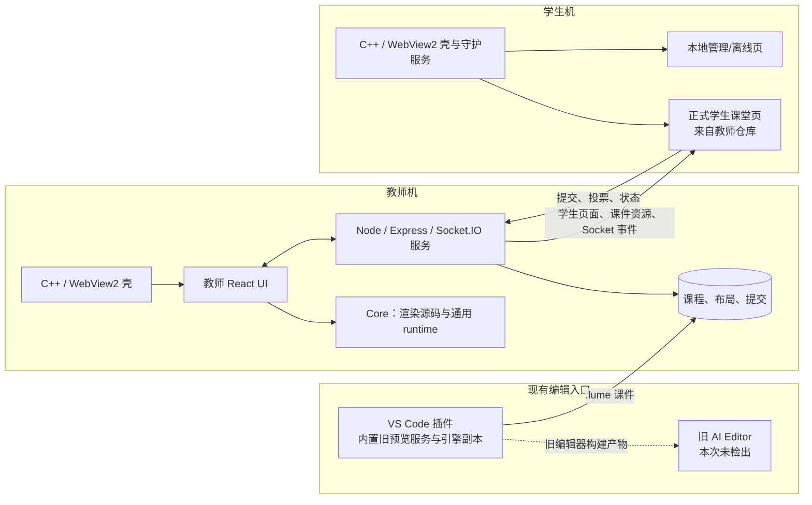
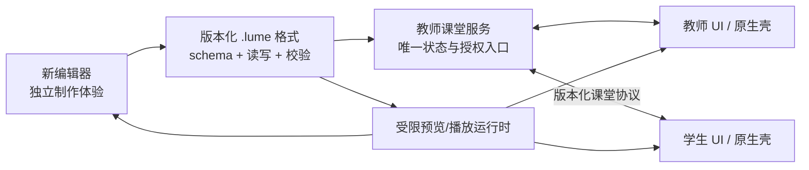

# 源码级架构评估与改进建议

审查日期：2026-09-25。审查范围：根工作区、教师端 `e4c480b`、学生端 `0898e88`、Core `1c3df08`、VS Code 插件 `428f4a3`，包括主要入口、服务、UI、原生壳、协议、构建脚本与现有测试。旧 AI Editor 当时未克隆。本报告保留**并仓前的历史静态证据**；2026-09-27 的目录与来源见[源码迁移记录](../status/submodules.md)，当前待办见[实施 TODO](../status/todo.md)。Windows 原生构建和三端集成仍未运行。

## 结论

“编辑器制课、教师端授课、学生端参与”的产品划分合理；实现中有三个更根本的边界问题：

1. **可信代码、课件代码和原生能力共处同一运行环境。**
2. **物理代码归属与产品职责不一致**：学生课堂页在教师仓库，Core 嵌在教师仓库，插件复制旧服务/引擎。
3. **没有可重复构建的版本组合**：两个 gitlink 指向远端当前不可取得的提交，根 CI 仍含旧路径。

建议先收紧信任边界和恢复可重复构建，再重整模块；不宜先大规模移动目录。

## 当前实际运行图

证据：学生壳跳转教师地址，见 `apps/student/desktop/shell/src/main.cpp` 的 `NavigateTeacher`；学生页面在 `apps/teacher/shared/public/student.html`，从教师服务加载 `/render-engine.js` 和 `/student-app.js`。教师服务入口为 `apps/teacher/server/index.js`，Core 的动态路径解析见 `server/src/core-paths.js`。

## 问题与证据

### P0：课件与原生能力的信任边界

- Core 用 Babel 在浏览器里编译 `.lume` 页面，再用 `new Function` 执行（`packages/course-runtime/src/browser/engine/runtime/app.tsx:127-160`、`:306-323`）。旧脚本课件也直接 `new Function`（同文件 `:570-585`）。这些代码与课堂页面共享 JavaScript 环境。
- 学生 WebView2 向页面注入 `window.studentHost`，其中包含配置写入、截图和关机/重启等原生操作（`apps/student/desktop/shell/src/main.cpp:654-708`）。消息回调只按 action 分派，未检查消息来源（`:1261-1269`、`:1454-1466`）；权限请求回调直接允许（`:1289-1295`）。教师壳也注入含导入、导出与设置接口的 `teacherHost`（`apps/teacher/native/shell/src/main.cpp:542-609`），消息回调未检查来源（`:1155-1165`）。
- 结果：如果导入的课件不完全可信，课件代码原则上能接触宿主页面和暴露的原生桥。建议把课件执行放到独立 origin/隔离 WebView，使用小型、按角色授权的消息 API；原生壳必须核验来源与动作，不能仅靠页面自行约束。

### P0：教师服务缺少统一鉴权边界

- `POST /api/session/bootstrap` 对声明为 host 的请求直接返回服务器 host token（`apps/teacher/server/index.js:146-165`）。
- API 路由同时挂在 `/api` 和 `/api/teacher`，入口未看到鉴权中间件（同文件 `:131-132`）；路由里包含删除课件、改文件夹、保存布局和修改提交目录（`apps/teacher/server/src/routes.js:157-170`、`:204-320`）。
- 教师 Socket 在无效或缺失 token 时会回退到基于 IP 的角色判断，本机地址可成为 host（`apps/teacher/server/src/socket.js:27-50`）。这与 Core runtime 较严格的 token 校验和可关闭的 legacy 模式不同（`packages/course-runtime/src/node/runtime-control.ts:62-129`、`:260-265`）。
- 教师 Socket 的 `register-dependencies` 与旧 `annotation-add` 事件没有角色限制（`apps/teacher/server/src/socket.js:433-442`、`:767-780`）。前者能改写服务端依赖 URL 映射，后续由代理下载（`server/src/proxy.js:152-164`）；另外，`/images/proxy` 按请求提供的 URL 发起服务器端请求（`server/src/proxy.js:390-435`）。这些入口需要来源限制、角色校验与目标地址策略。
- 提交相关 HTTP 路由接收调用者传入的 `courseId`、`fileName`，直接参与路径拼接（`apps/teacher/server/src/routes.js:373-392`、`server/src/submissions.js:149-189`）；缺少统一的路径边界校验。应把文件系统访问封装到只接受规范化课程 ID 的存储层。
- 建议让教师服务成为唯一课堂鉴权入口；host 凭证只通过本机受保护通道发给教师壳，HTTP 写入路由和 Socket 命令使用相同的角色授权，淘汰 IP 猜测角色。

### P1：代码归属与运行时重复

- 学生仓库的 UI 源码主要是管理页和离线页（`apps/student/ui/student-host/src/admin.ts`、`offline.ts`），正式学生页在教师仓库。这让学生端版本实际跟随教师端发布，学生仓库无法单独对课堂 UI 做完整构建验证。
- 教师服务从 Core 的 `dist/cjs` 按路径加载模块，缺失时回退到 `packages/*`（`apps/teacher/server/src/core-paths.js:29-61`）。Core 又提供独立 HTTP/Socket runtime 服务及兼容空课程 API（`packages/course-runtime/src/server/create-core-server.ts:32-120`）；教师服务另实现约 900 行课堂 Socket 协议。两者的身份和事件语义并不相同。
- 插件保留一份旧服务与引擎（`repos/editor-plugin/src/packages/server`、`src/packages/engine`）。校验文件哈希可见，插件服务中的 `courses.js`、`data.js`、`proxy.js`、`routes.js`、`socket.js` 与 Core 的 `packages/server/src` 对应文件逐字相同，却已不同于教师服务版本。这是实质性的分叉维护。
- 建议确定**一个正式课堂服务**（教师服务）；Core 的共享包只负责格式、渲染与必要的纯逻辑。现有 VS Code 插件已决定退出目标架构，应解除其构建和发布依赖；学生课堂 UI 的源码和构建放回学生端，教师服务只分发带版本号的学生资源。

### P1：课件格式与编辑器边界不稳定

- 当前播放路径把 Zip `.lume` 的 `manifest.json`、页面源码和资源在浏览器内解析/编译（`packages/course-runtime/src/browser/engine/runtime/app.tsx:250-343`）。与此同时，教师仓库仍带旧脚本课件与迁移器，运行时也保留旧入口。
- VS Code 插件的 `CustomTextEditorProvider` 把 `.lume` 当作文本读入、生成单页源码，再在保存时用文本覆盖整个文档（`repos/editor-plugin/src/extension.ts:175-199`、`:885-940`）。对 Zip 格式课件，这条路径存在破坏包内容的风险；插件现已退出目标架构，不应继续作为课件编辑入口。
- 插件构建会尝试复制旧 AI Editor 的 `dist`，找不到时仅警告并继续（`repos/editor-plugin/esbuild.js:62-77`）；自定义编辑器运行时则读取该产物（`src/extension.ts:201-228`）。按当前“不再克隆旧 AI Editor”的决定，这条路径不应作为新编辑器方案。
- 建议先定义版本化的 `.lume` schema、校验器和读写库；新编辑器与播放器都依赖它。旧脚本课件需要迁移兼容层；旧插件预览不进入新架构。新编辑器设计时先确定课件模型与预览 API，再选择 UI 宿主。

### P1：版本与发布不可复现

- 根仓锁定的学生提交 `c7b7373` 和教师端内的 Core 提交 `1c0de62` 不在当前可取得的远端历史中。当前检出分别是 `0898e88` 与 `1c3df08`，未经兼容测试，不能视为原组合。
- 根 `.github/workflows/release.yml` 与 `build-branch.yml` 仍引用旧路径和命令，详见[根仓审查](../status/audit.md)。教师服务启动时会尝试构建 UI bundle，失败只警告后继续运行（`apps/teacher/server/index.js:93-101`），可能使用旧产物。
- 建议保存可获取的版本基线，先在 CI 固定三端组合并做 Windows 构建与最小连课烟测；构建产物必须在发布前生成，启动阶段缺失时应明确失败。

### P2：状态、数据与测试组织

- 教师服务把课程/页码放在路由模块的进程变量（`apps/teacher/server/src/routes.js:22-25`），把设置、在线者、截图、标注和投票放在 Socket 模块的多个内存集合（`server/src/socket.js:53-103`）。重启会丢失运行中状态，跨 HTTP/Socket 的一致性靠模块函数维持。
- `socket.js` 约 900 行，教师 UI 的 `app.tsx`、`course-selector.tsx`、`classroom-view.tsx` 各约 1500–1700 行；职责和副作用较难隔离。可以按会话、成员、课程、互动、提交拆模块，并以单一课堂状态对象和明确事件迁移管理。
- Core 只有身份和通用转发的少量测试，插件测试仍是样例；未找到教师/学生端集成测试。建议优先补“教师服务 + 学生连接 + 选课/翻页/提交”的协议测试，而不是逐函数补覆盖率。

## 建议的目标边界

约束：

1. 教师服务拥有课堂会话、课程目录、提交和授权；独立 Core 服务退出正式课堂路径。
2. 格式与渲染作为共享版本化包，可从多个端消费，但不直接拥有业务数据。
3. 教师/学生各自拥有本端 UI 和原生桥。课件运行于受限环境，通过授权后的窄接口访问课堂能力。
4. 编辑器是独立产品端；旧 AI Editor 和 VS Code 插件均不进入目标架构，新编辑器从课件契约与预览能力重新设计。
5. 根仓继续作为集成与发布仓可以接受，但必须有可获取的 gitlink、版本矩阵和跨端 CI。

## 改造顺序

| 阶段 | 目标 | 可交付结果 |
| --- | --- | --- |
| 0 | 固定可构建基线并保护现有课堂 | 查明或替换失效 gitlink；给 host bootstrap、HTTP 写接口、Socket 命令和原生桥加授权/来源校验；禁止不可信课件直达原生能力 |
| 1 | 建立共享契约 | `.lume` schema/校验器、HTTP/Socket 事件类型与版本握手、最小跨端协议测试 |
| 2 | 归位代码所有权 | 学生课堂 UI 移入学生端；解除旧插件的构建与发布依赖；Core 明确为共享库并收敛重复 runtime |
| 3 | 内部分层 | 教师端拆分会话、课程、互动、提交服务；构建与运行分离；数据路径、迁移和备份策略确定 |
| 4 | 设计新编辑器 | 基于稳定格式和预览 API 独立设计新编辑器，不接入 VS Code 插件 |

这个顺序能先保证课堂系统和课件数据可控，再降低仓库间耦合；暂不要求立刻合并或拆分 Git 仓库。

## 验证记录与限制

- 已检查仓库源码树、入口文件、主要业务模块、原生桥、构建配置、现有测试与静态页面；已对教师服务和插件服务的 Node 源文件执行 `node --check`，语法通过。
- 未安装依赖或运行 Windows 原生程序；Core 测试需要先构建 `dist`，教师/学生端未找到覆盖正式连课流程的自动化测试。
- 学生端/Core 为可取得的远端当前版本，不是上级锁定版本；旧 AI Editor 未读取。需要在版本基线修复后复核所有跨端结论。
