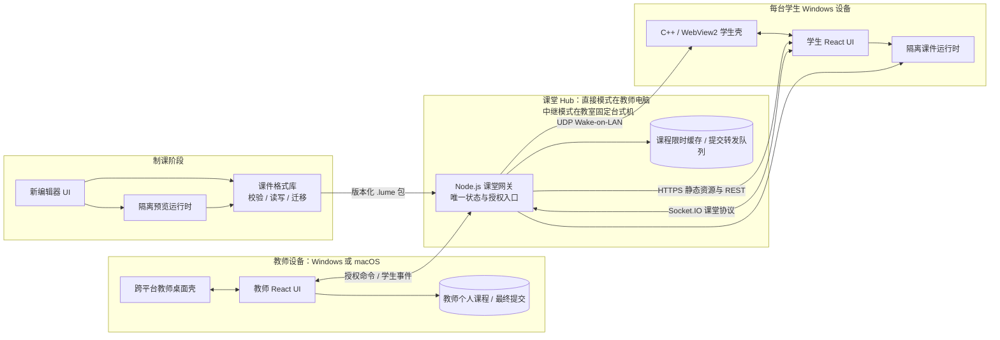
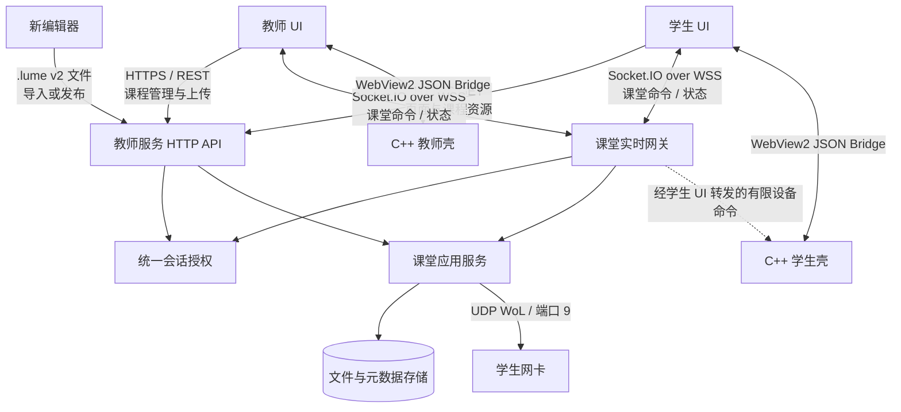
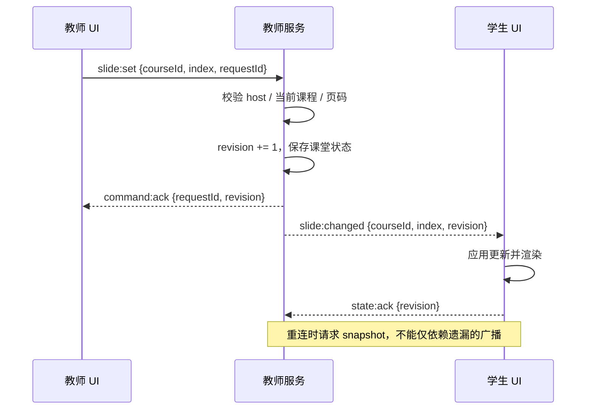

# 三端目标架构设计（讨论稿）

日期：2026-09-25。本文是在[源码级评估](source-review.md)基础上的**目标设计**，不是已实现功能说明，也不代表现在开始迁移或修复。旧 AI Editor 与 VS Code 插件均不纳入目标架构；新编辑器在格式和协议确定后独立设计。教师端新增 Windows/macOS 与固定机中继模式，详见[跨平台教师端专项设计](teacher-cross-platform-relay.md)。学生端和 Core 当前检出与上级锁定提交不一致，因此现状细节仍需在可复现基线建立后做集成验证。

## 1. 产品与部署边界

LumeSync 由三个产品端组成。直接模式由教师电脑承载课堂服务；中继模式由教室固定台式机承载课堂 Hub，教师自带电脑负责课程内容与授课控制。Core 应从“另一套可独立控制课堂的服务”收敛为被三个端依赖的共享包。



目标原则：课堂 Hub 是状态的单一写入者，教师端持有唯一授课控制租约；学生只缓存和展示 Hub 发布的状态；课件运行时不能直接获得教师或学生壳的原生权限。编辑器负责生成课件，不参与课堂实时控制。中继模式的固定机只负责连接、转发、限时缓存和可选只读投影。

## 2. 现有技术栈与建议保留/调整

| 模块 | 当前源码实际使用 | 目标设计建议 |
| --- | --- | --- |
| 教师桌面壳 | C++20（以 CMake/MSVC 构建）、Win32、WebView2；WinHTTP 请求本机教师服务 | 建议迁移到 Windows/macOS 共用的 Electron 宿主；以受限 preload 接口提供窗口、文件和本地系统能力，旧 Windows 壳仅作过渡 |
| 教师页面 | TypeScript/TSX、React 18、ReactDOM；Babel Standalone 编译后输出浏览器脚本；部分页面引用 Tailwind 等静态库 | 继续用 TypeScript + React；改为构建期打包和类型检查，不在服务启动时临时编译 |
| 课堂服务 | JavaScript/Node.js、Express 4、Socket.IO 4；文件系统保存课程、布局与提交 | 提炼为跨平台 Classroom Hub：直接模式在教师电脑，中继模式在教室固定机；业务层改为 TypeScript，持久化与临时转发队列分开 |
| 学生桌面壳 | C++20（以 CMake/MSVC 构建）、Win32、WebView2；另有 Windows Guard Service；WinHTTP 从教师服务领取 viewer 会话 | 第一阶段保留；本地管理/离线页与课堂页均由学生端仓库构建；限制 WebView 来源及原生能力 |
| 学生页面 | 本地管理/离线页为 TypeScript；正式课堂页是教师仓库中的 React/Babel 页面 | 正式课堂 UI 归学生端所有，TypeScript + React，构建成版本化静态资源；教师服务只分发产物 |
| 课件播放 | Core 的 TypeScript/TSX + React 运行时；JSZip 解包；Babel Standalone 编译课件 TSX 并以 `new Function` 执行 | 共享课件格式库与受限运行时分离；可编辑内容通过受控消息接口与宿主通信；旧课件交由兼容/迁移模块处理 |
| 现有 VS Code 插件（遗留） | TypeScript、VS Code Extension API、esbuild；复制旧服务/引擎代码，并依赖旧 AI Editor 构建产物 | 停止作为产品端维护；不迁移进目标架构，新编辑器不依赖它 |
| 文档/下载站 | 根仓的 Next.js/Nextra 文档站及独立下载站 | 属于发布与文档系统，不进入课堂运行时依赖链 |

表中目标技术是迁移建议，尚未决定具体 UI 打包器、数据库或新编辑器宿主。新编辑器可以是桌面或 Web 应用；应在课件数据模型与用户流程定稿后选择。

## 3. 当前实际通信协议

> 下表"主要问题"列记录**设计时（2026-09-25）的源码评估结论**。其中身份凭证、HTTP 授权与协议版本三项已完成首轮加固（见[迁移状态](../status/migration.md)与[共享契约包](../reference/contracts.md)），其余问题仍然成立。

| 通信双方 | 当前传输与内容 | 代码证据 | 主要问题 |
| --- | --- | --- | --- |
| 教师壳 → 教师服务 | 本机 HTTP `POST /api/session/bootstrap`，返回 host token；页面通过 HTTP 加载 | `repos/teacher/native/shell/src/main.cpp`、`repos/teacher/server/index.js` | host token 发放未核实本机进程身份 |
| 学生壳 → 教师服务 | 局域网 HTTP `POST /api/session/bootstrap`，获取 viewer token；WebView2 导航教师机 `http://IP:port` | `repos/student/native/shell/src/main.cpp` | 凭证和页面当前经明文 HTTP 传输 |
| 教师/学生页面 ↔ 教师服务 | Socket.IO（HTTP 长轮询/WebSocket 由 Socket.IO 协商），JSON 事件；如 `select-course`、`course-changed`、`sync-slide`、`student:submit`、`student:screenshot` | `repos/teacher/server/src/socket.js`、`repos/teacher/shared/teacher-shell/src/app.tsx`、`repos/student/ui/classroom/src/classroom-app.js`（学生课堂页已从教师仓库归位到学生端，见[迁移状态](../status/migration.md)） | 部分事件授权不一致，身份、事件 schema 与重连语义不统一 |
| 页面 ↔ 原生壳 | WebView2 `window.chrome.webview.postMessage` / `WebMessageReceived`，JSON action 和返回消息；页面包装为 `teacherHost`/`studentHost` | 两端 `native/shell/src/main.cpp` | 原生桥暴露给加载页面，消息来源校验缺失 |
| 浏览器/壳 → 教师服务 | HTTP 静态资源、`/api/*` REST 风格接口；课程、导出、布局、提交 | `repos/teacher/server/index.js`、`server/src/routes.js` | 写接口缺统一授权；路径输入需要约束 |
| 教师服务 → 学生网卡 | UDP IPv4 广播 Wake-on-LAN 魔术包，默认端口 9 | `repos/teacher/server/src/socket.js` | 这是设备唤醒旁路，不属于课堂可靠消息通道 |
| 编辑器 → 教师端 | `.lume` 文件导入/复制；当前没有稳定的在线发布协议 | Core 课件加载与插件源码 | 文件格式与插件编辑方式不一致 |

当前 Socket.IO 并不等于裸 WebSocket；浏览器与服务端仍使用 Socket.IO 的握手、重连和事件语义。文中的 HTTPS/WSS 为**目标协议**，当前局域网实现是 HTTP/Socket.IO。

## 4. 目标通信架构



### 4.1 HTTP API：低频请求与文件

- `GET /api/v1/courses`、`GET /api/v1/courses/{id}`：课程目录与元数据；学生只可读当前课堂允许的课程。
- `POST /api/v1/courses`、`DELETE /api/v1/courses/{id}`：教师导入/删除课件；请求必须通过 host 会话鉴权，上传前先校验 ZIP 条目、大小、路径和 manifest。
- `GET /api/v1/classrooms/{id}/snapshot`：重连时获取权威快照，包括课程、页码、设置、会话版本。
- `POST /api/v1/submissions`、`GET /api/v1/submissions?...`：学生提交与教师查询/下载；提交需绑定会话身份和课程，文件名不直接决定存储路径。
- 静态资源按构建版本、内容 hash 和课程 ID 分发；课堂实时命令不通过文件 API 实现。

这些路径是**建议的接口形状**，不是现有 API 清单。正式定义应在共享契约包中以请求/响应 schema 固化，并生成客户端类型。

### 4.2 Socket.IO：实时课堂协议

一个课堂只有一个权威状态对象。教师端发命令，Hub 校验角色并更新状态，随后广播带版本的事件；学生端不能自行决定全班课程或页码。中继模式由教师端通过 mDNS 自动发现固定机，固定机在收到连接请求后显示验证码，教师在自己的电脑输入；验证后取得唯一授课租约和租约代次 `epoch`，详见[专项设计](teacher-cross-platform-relay.md#5-局域网自发现与验证码接入)。

| 类别 | 建议消息 | 发送方 → 接收方 | 语义 |
| --- | --- | --- | --- |
| 握手 | `session:hello` / `session:accepted` | 客户端 ↔ 服务端 | 传协议版本、设备 ID、短期会话凭证；不匹配时明确拒绝 |
| 状态快照 | `classroom:snapshot` | 服务端 → 客户端 | 重连后覆盖本地旧状态，附 `revision` |
| 课程控制 | `course:select` / `course:selected`、`course:end` / `course:ended` | 教师 → 服务端 → 全班 | 命令与已提交状态分开命名；仅 host 可发命令 |
| 页面同步 | `slide:set` / `slide:changed` | 教师 → 服务端 → 全班 | 带课程 ID、页码和递增 `revision`；过期消息丢弃 |
| 学生互动 | `submission:create`、`vote:respond`、`annotation:add` | 学生 → 服务端 | 校验设备身份、当前课程、频率和 payload 大小 |
| 设备管理 | `device:power:request` / `device:power:result` | 教师 → 服务端 → 指定学生 | 单设备定向、审计、回执；原生壳再次核验动作 |
| 中继接入 | mDNS 发现、`teacher:pair.*`、`teacher:lease.*` | 教师电脑 ↔ 固定 Hub | 搜索设备、固定机显示验证码、教师电脑输入验证、取得唯一控制权；直接模式不经过远程配对 |
| 课件发布 | `course:stage`、`course:publish` | 教师电脑 → 固定 Hub | 上传并校验内容 hash 后发布；旧版本在新版本就绪前继续播放 |

建议统一信封：`{protocolVersion, classroomId, requestId, revision?, sentAt, payload}`。`requestId` 支持命令回执和重试去重；`revision` 支持断线恢复和乱序识别。事件 schema、角色矩阵与错误码应由 `classroom-protocol` 包维护。截图等大数据不宜作为无限制 Socket 广播；要限制大小、采样频率和目标观众，必要时改为一次性上传 URL。



### 4.3 WebView2 原生桥：系统能力

教师端建议改用 Electron 的受限 preload IPC，学生端仍使用 WebView2 消息桥；两者分别暴露最小能力列表。消息建议统一为 `{version, requestId, action, payload}`，响应为 `{requestId, ok, result?, error?}`。Electron 主进程与学生壳均校验消息来源、窗口角色、action 白名单和参数 schema。课件 iframe/隔离 WebView 不能直接调用原生能力。直接模式的教师身份走仅本机进程可访问的通道；中继模式通过固定机配对和唯一授课租约取得控制权，不能由公开 HTTP 接口领取 host token。

### 4.4 传输与信任

- 教师机只开放课堂所需端口；正式部署建议 HTTPS + Socket.IO over WSS，并定义本地证书或受管证书分发方案。离线局域网可先做受控过渡，但不能把明文 HTTP 当成最终安全边界。
- viewer 会话由设备配对/入班流程签发短期凭证；host 凭证仅教师本机持有。服务端对每个 HTTP 路由与 Socket 命令统一执行角色和资源授权。
- 课件视为可能不可信的输入。预览和课堂播放使用隔离 origin/进程或同等有效的沙箱策略，课件访问网络、原生桥和课堂事件必须经宿主授权。
- Wake-on-LAN 只发送魔术包，不承担认证、状态确认或关机命令；关机/重启必须走已认证的设备控制流程。

## 5. 课件格式与运行时

现有 ZIP `.lume` 包已使用 `manifest.json`、`schemaVersion`、`runtime.format=lumesync-zip`、页面 TSX 和 `assets/`；同时存在旧的纯文本脚本课件。目标格式暂称 **`.lume v2`**，版本号仅是设计占位，真正版本需在迁移器与样本测试后确定。

```text
course.lume  (ZIP)
├── manifest.json      # schemaVersion、id、title、runtimeVersion、页面顺序
├── slides/            # 页面源码或编译产物；最终形态待安全设计确定
└── assets/            # 图片、音频等，路径相对包根目录
```

`course-format` 负责解析、写入、校验和迁移，不含 UI；`course-runtime` 负责在受限环境播放。编辑器保存时应原子替换完整 ZIP，而不是将其作为文本覆盖。导入教师端时使用同一校验器；运行时按明确的 `schemaVersion` 与 `runtimeVersion` 选择播放器，不在课堂中默默猜测格式。旧课件先做只读兼容与显式迁移，并保留原文件备份。

## 6. 模块归属与建议仓库结构

建议最终采用一个 pnpm 工作区管理跨端 TypeScript 契约。教师桌面端构建 Windows/macOS 包，学生 Windows C++ 壳继续由 CMake 构建。此结构是**目标逻辑目录**；是否合并现有 Git 仓库可在建立可构建基线后决定，模块边界不依赖 Git 形式。

```text
apps/
  teacher/
    desktop/              # Windows/macOS Electron 宿主
    ui/                   # 教师 React UI
    session-agent/        # 直接/中继连接、课件发布与重连
  classroom-hub/
    server/               # Express HTTP + Socket.IO，单一课堂状态入口
    projector/            # 固定机可选只读投影
  student/
    desktop/              # C++ / WebView2 壳、Windows Guard Service
    ui/                   # 本地管理/离线 + 正式课堂 UI
  editor/
    app/                  # 重新设计的新编辑器（宿主待定）
packages/
  course-format/          # .lume schema、ZIP 读写、迁移
  course-runtime/         # 隔离播放器与预览能力
  classroom-protocol/     # HTTP/Socket schema、角色、错误码与版本
  native-contract/        # Electron IPC / WebView2 消息 schema 与能力清单
  teacher-platform/       # 教师端文件、窗口、日志等跨平台 API
docs/                     # 当前架构、运维、开发和历史资料
```

| 数据或能力 | 唯一所有者 | 其他模块如何使用 |
| --- | --- | --- |
| 课程包格式与校验 | `course-format` | 编辑器写，教师服务导入，播放器读 |
| 当前课堂课程、页码、设置、成员 | Classroom Hub 的课堂域 | 唯一授课教师发命令，学生消费快照/事件 |
| 教师个人课程与最终提交 | 教师电脑的存储层 | 直接模式由本机 Hub 访问；中继模式由固定 Hub 限时缓存与转发 |
| 学生课堂界面与本机配置 | 学生端 | 教师服务只分发 UI 构建产物 |
| 桌面窗口、截图、电源和设备权限 | 各端原生壳 | 页面通过最小化原生桥申请能力 |
| 编辑草稿与制课交互 | 新编辑器 | 只通过课件格式与预览契约连接课堂系统 |

## 7. 迁移顺序与验收点

1. **建立基线**：修复不可取得的子模块提交，固定版本矩阵；跑通 Windows 教师/学生构建、两机连课、翻页与提交的最小烟测。
2. **封闭现有风险入口**：收紧 host bootstrap、HTTP/Socket 权限、原生桥来源与路径校验；保留旧协议兼容窗口，记录客户端版本。
3. **抽出共享契约**：定义 `.lume` schema、课件读写库、课堂协议及 WebView2 消息 schema；用跨端契约测试验证教师/学生组合。
4. **归位代码**：学生课堂 UI 回学生端；移除旧插件对工作区构建和发布的依赖；Core 只保留共享运行能力；课堂 Hub 成为唯一状态中心。教师桌面端通过跨平台会话代理接入本机或固定机 Hub；旧插件源码是否归档由后续仓库整理决定，不进入新架构。
5. **重新设计编辑器**：先确定课件模型、资源管理、预览和导出流程，再决定桌面/Web 宿主；与播放器共用同一格式库和预览运行时。

验收重点是：同一课件在编辑器预览、教师播放、学生播放结果一致；学生断线重连能获得正确状态；未授权客户端不能控制课堂或调用原生系统能力；发布包可以从锁定版本在 CI 中重复构建。

## 8. 尚需决策的问题

1. 新编辑器优先做 Windows 桌面应用，还是跨平台 Web/桌面双形态？决定 UI 宿主和本地文件访问方案，但不改变课件契约。
2. 课件页面是否继续允许任意 TSX/JavaScript？若允许，必须先选定真正的隔离执行方案；若改为声明式组件模型，需评估旧课件迁移成本。
3. 教室是否必须完全离线运行？这决定证书分发、资源缓存和在线发布入口。
4. 课堂状态在教师服务重启后恢复到什么程度？至少应明确课程、页码、提交与互动会话各自的持久化要求。

以上决策尚未在代码中实施；现有功能和风险以[源码级评估](source-review.md)与[功能清单](../reference/features.md)为准。
